

TRƯỜNG ĐẠI HỌC KIẾN TRÚC HÀ NỘI  
KHOA CÔNG NGHỆ THÔNG TIN

---

*[LOGO TRƯỜNG ĐẠI HỌC KIẾN TRÚC HÀ NỘI]*

---

# BÁO CÁO KIỂM TRA TIẾN ĐỘ ĐỒ ÁN LẦN 1

### ĐỀ TÀI
## NGHIÊN CỨU VÀ XÂY DỰNG HỆ THỐNG
## HỌC TẬP ĐA NỀN TẢNG CÁ NHÂN HÓA
## SỬ DỤNG SPACED REPETITION VÀ MACHINE LEARNING

Lớp: `22CN2`

| Vai trò | Họ và tên |
| :--- | :--- |
| Giảng viên hướng dẫn: | ThS. Trần Văn Thắng |
| Sinh viên thực hiện: | Nguyễn Đỗ Hải Nam |

Hà Nội, tháng 11 năm 2026

---
<!-- NGẮT TRANG (PAGE BREAK) -->
---

TRƯỜNG ĐẠI HỌC KIẾN TRÚC HÀ NỘI  
KHOA CÔNG NGHỆ THÔNG TIN

***

*[LOGO TRƯỜNG ĐẠI HỌC KIẾN TRÚC HÀ NỘI]*

---

# BÁO CÁO KIỂM TRA TIẾN ĐỘ ĐỒ ÁN LẦN 1

### ĐỀ TÀI
## NGHIÊN CỨU VÀ XÂY DỰNG HỆ THỐNG
## HỌC TẬP ĐA NỀN TẢNG CÁ NHÂN HÓA
## SỬ DỤNG SPACED REPETITION VÀ MACHINE LEARNING

Hà Nội, tháng 11 năm 2026

---
<!-- NGẮT TRANG (PAGE BREAK) -->
---

## DANH MỤC HÌNH ẢNH

- Hình 2.1: Sơ đồ phân rã chức năng hệ thống SmartFlash
- Hình 2.2: Sơ đồ Use Case tổng quát của hệ thống SmartFlash
- Hình 2.3: Sơ đồ Use Case chi tiết phân hệ Xác thực và Hồ sơ cá nhân
- Hình 2.4: Sơ đồ Use Case chi tiết phân hệ Quản lý học liệu, OCR và Media
- Hình 2.5: Sơ đồ Use Case chi tiết phân hệ Học tập thông minh FSRS và DKT
- Hình 2.6: Sơ đồ Use Case chi tiết phân hệ Kiểm tra, Minigames và Đấu trường Live
- Hình 2.7: Sơ đồ Use Case chi tiết phân hệ Trợ lý AI Chatbot (Q-Chat)
- Hình 2.8: Sơ đồ Use Case chi tiết phân hệ Lớp học và Công cụ Giáo viên
- Hình 2.9: Sơ đồ Use Case chi tiết phân hệ Gamification và Quản trị Hệ thống
- Hình 2.10: Sơ đồ kiến trúc tổng thể hệ thống
- Hình 2.11: Sơ đồ luồng xác thực tập trung (JWT và Google OAuth2)
- Hình 2.12: Sơ đồ luồng trích xuất thẻ từ ảnh chụp tài liệu (OCR Pipeline)
- Hình 2.13: Sơ đồ luồng học tập bất đồng bộ kết hợp FSRS-4.5 và DKT
- Hình 2.14: Sơ đồ luồng AI Chatbot tạo bộ thẻ và chuyển tiếp sang màn hình CRUD
- Hình 2.15: Sơ đồ quan hệ thực thể tổng thể (ERD) của cơ sở dữ liệu PostgreSQL

---

## DANH MỤC BẢNG BIỂU

- Bảng 1.1: So sánh định hướng tham khảo từ Quizlet và nâng cấp trong hệ thống SmartFlash
- Bảng 1.2: Danh mục công nghệ sử dụng trên các nền tảng của hệ thống
- Bảng 2.1: Phân tích yêu cầu phi chức năng của hệ thống
- Bảng 2.2: Phân quyền chi tiết theo 4 vai trò người dùng (RBAC)
- Bảng 2.3: Đặc tả Use Case UC-01 — Đăng nhập hệ thống
- Bảng 2.4: Đặc tả Use Case UC-02 — Quản lý quyền riêng tư trang cá nhân
- Bảng 2.5: Đặc tả Use Case UC-03 — Tạo mới và chỉnh sửa bộ thẻ Flashcard
- Bảng 2.6: Đặc tả Use Case UC-04 — Trích xuất cặp thuật ngữ và định nghĩa từ ảnh
- Bảng 2.7: Đặc tả Use Case UC-05 — Học thẻ thông minh theo lịch FSRS và DKT
- Bảng 2.8: Đặc tả Use Case UC-06 — Giáo viên chỉ định hoạt động không cần đăng nhập
- Bảng 2.9: Tổng hợp cấu trúc cơ sở dữ liệu PostgreSQL qua 3 file Flyway Migration
- Bảng 2.10: Đặc tả chi tiết một số bảng cốt lõi đã triển khai
- Bảng 3.1: Bảng theo dõi tiến độ thực hiện đồ án theo từng Phase
- Bảng 3.2: Danh sách các nhóm API đã hoàn thiện và kiểm thử ở Phase 2 và Phase 3
- Bảng 3.3: Bảng tổng hợp kết quả kiểm thử hệ thống đến đợt tiến độ lần 1

---

## MỤC LỤC

- DANH MỤC HÌNH ẢNH
- DANH MỤC BẢNG BIỂU
- MỤC LỤC
- LỜI CẢM ƠN
- LỜI MỞ ĐẦU
- CHƯƠNG 1. CƠ SỞ LÝ THUYẾT
  - 1.1 Tổng quan về đề tài
  - 1.2 Thuật toán lặp lại ngắt quãng FSRS-4.5
  - 1.3 Học sâu theo dõi tri thức DKT
  - 1.4 Công nghệ nhận diện ký tự quang học (OCR) và trợ lý AI theo ngữ cảnh
  - 1.5 Công cụ và công nghệ sử dụng
- CHƯƠNG 2. PHÂN TÍCH VÀ THIẾT KẾ HỆ THỐNG
  - 2.1 Phân tích yêu cầu chức năng và phi chức năng
  - 2.2 Phân quyền người dùng (RBAC 4 vai trò)
  - 2.3 Sơ đồ phân rã chức năng
  - 2.4 Thiết kế ca sử dụng (Use Case)
  - 2.5 Kiến trúc tổng thể và các sơ đồ luồng xử lý
  - 2.6 Thiết kế cơ sở dữ liệu (PostgreSQL 16+)
- CHƯƠNG 3. KẾT QUẢ TRIỂN KHAI TIẾN ĐỘ LẦN 1 VÀ KIỂM THỬ
  - 3.1 Tổng quan tiến độ thực hiện đến thời điểm kiểm tra lần 1
  - 3.2 Kết quả triển khai Backend và cơ sở dữ liệu
  - 3.3 Kết quả triển khai dịch vụ AI/ML
  - 3.4 Kết quả triển khai giao diện Web
  - 3.5 Kết quả triển khai ứng dụng di động Android
  - 3.6 Kết quả kiểm thử hệ thống
- KẾT LUẬN VÀ HƯỚNG PHÁT TRIỂN
- TÀI LIỆU THAM KHẢO

---
<!-- NGẮT TRANG (PAGE BREAK) -->
---

## LỜI CẢM ƠN

Để hoàn thành báo cáo kiểm tra tiến độ đồ án lần 1 với đề tài "Nghiên cứu và xây dựng hệ thống học tập đa nền tảng cá nhân hóa sử dụng Spaced Repetition và Machine Learning", em xin gửi lời cảm ơn sâu sắc nhất đến thầy ThS. Trần Văn Thắng, giảng viên hướng dẫn trực tiếp của em trong suốt quá trình nghiên cứu và thực hiện đồ án.

Thầy đã luôn tận tâm theo sát, định hướng rõ ràng về mặt kiến trúc hệ thống, gợi mở các giải pháp kỹ thuật phù hợp giữa phần mềm đa nền tảng và các mô hình trí tuệ nhân tạo, đồng thời đưa ra những nhận xét, góp ý quý báu giúp em từng bước tháo gỡ khó khăn và giữ vững tiến độ đề ra.

Em cũng xin chân thành cảm ơn các thầy cô trong Khoa Công nghệ Thông tin, Trường Đại học Kiến trúc Hà Nội đã trang bị cho em nền tảng kiến thức vững chắc trong suốt thời gian học tập tại trường, làm cơ sở để em vận dụng vào quá trình phân tích, thiết kế và xây dựng hệ thống thực tế.

Dù đã dành nhiều thời gian và nỗ lực nghiêm túc để hoàn thiện báo cáo tiến độ giai đoạn 1, nội dung trình bày chắc chắn vẫn còn những thiếu sót nhất định. Em rất mong tiếp tục nhận được những ý kiến đóng góp, chỉ bảo của thầy ThS. Trần Văn Thắng và quý thầy cô để đồ án ngày càng hoàn thiện hơn trong các giai đoạn tiếp theo.

---
<!-- NGẮT TRANG (PAGE BREAK) -->
---

## LỜI MỞ ĐẦU

Trong bối cảnh giáo dục hiện đại đang chuyển mình mạnh mẽ theo hướng chuyển đổi số, việc ứng dụng trí tuệ nhân tạo và các nền tảng học tập thông minh vào hỗ trợ tự học đã trở thành một xu thế tất yếu. Trong số các phương pháp ghi nhớ kiến thức, học tập qua thẻ ghi nhớ kết hợp lặp lại ngắt quãng đóng vai trò quan trọng giúp người học tối ưu hóa thời gian ôn tập và nâng cao khả năng ghi nhớ dài hạn.

Tuy nhiên, các hệ thống học tập truyền thống trong thực tế thường mới chỉ dừng lại ở việc lưu trữ thẻ tĩnh hoặc áp dụng lịch ôn tập cứng nhắc, chưa khai thác được chuỗi lịch sử tương tác để cá nhân hóa lộ trình theo năng lực thực tế của từng người học, đồng thời còn tốn nhiều công sức ở khâu nhập liệu từ tài liệu giấy. Chính vì lẽ đó, đề tài "Nghiên cứu và xây dựng hệ thống học tập đa nền tảng cá nhân hóa sử dụng Spaced Repetition và Machine Learning" được thực hiện nhằm xây dựng một hệ thống hỗ trợ học tập đồng bộ trên cả web và di động Android.

Đặc biệt, nhằm nâng cao độ chính xác cá nhân hóa và trải nghiệm người dùng, nghiên cứu này chú trọng kết hợp thuật toán lặp lại ngắt quãng thế hệ mới FSRS-4.5 với mô hình học sâu theo dõi tri thức DKT trên nền tảng PyTorch LSTM, tích hợp công nghệ nhận diện ký tự quang học OCR tiếng Việt và trợ lý AI theo ngữ cảnh. Giải pháp này giúp người học tạo học liệu nhanh chóng, nhận biết mức độ thành thạo kiến thức và được điều chỉnh lộ trình ôn tập phù hợp theo thời gian thực.

Để hoàn thành được báo cáo tiến độ lần 1 này, em xin bày tỏ lòng biết ơn sâu sắc đến thầy ThS. Trần Văn Thắng, người đã trực tiếp dẫn dắt, luôn tận tâm chỉ bảo và đưa ra những định hướng khoa học kịp thời. Những góp ý của thầy là kim chỉ nam giúp em vượt qua các thách thức về kiến trúc đa nền tảng và tích hợp kỹ thuật để hoàn thành giai đoạn đầu của đồ án một cách tốt nhất.

Em cũng xin chân thành cảm ơn quý thầy cô Khoa Công nghệ Thông tin, Trường Đại học Kiến trúc Hà Nội cùng cộng đồng phát triển mã nguồn mở đã cung cấp nền tảng tri thức và công cụ quý giá để em triển khai các thực nghiệm và xây dựng hệ thống.

Dù đã nỗ lực hết sức với tinh thần nghiêm túc và cầu thị nhất, báo cáo tiến độ chắc chắn không tránh khỏi những thiếu sót về mặt kiến thức và kỹ thuật. Em rất mong nhận được những ý kiến đóng góp, nhận xét quý báu từ thầy để đồ án được hoàn thiện hơn và đạt chất lượng cao hơn trong các giai đoạn tiếp theo.

Em xin chân thành cảm ơn!

---
<!-- NGẮT TRANG (PAGE BREAK) -->
---

## CHƯƠNG 1. CƠ SỞ LÝ THUYẾT

### 1.1 Tổng quan về đề tài

#### 1.1.1 Giới thiệu đề tài
Hệ thống SmartFlash kế thừa trải nghiệm học tập trực quan, đa chế độ của nền tảng Quizlet bao gồm học thẻ ghi nhớ, kiểm tra, trò chơi tương tác, lớp học và chỉ định hoạt động cho học sinh. Trên nền tảng đó, hệ thống nâng cấp lõi học thuật bằng việc kết hợp thuật toán lập lịch ôn tập FSRS-4.5 (Free Spaced Repetition Scheduler) và mạng nơ-ron hồi quy DKT (Deep Knowledge Tracing).

Bên cạnh lõi cá nhân hóa, hệ thống tích hợp pipeline nhận diện ký tự quang học (OCR) giúp chuyển đổi nhanh ảnh chụp sách vở thành bộ thẻ flashcard và trợ lý AI chatbot theo ngữ cảnh. Trợ lý này hỗ trợ giải thích kiến thức, sinh bộ thẻ tự động và chuyển tiếp trực tiếp dữ liệu sang trình biên tập để người dùng rà soát trước khi lưu.

#### 1.1.2 Mục tiêu đề tài
Về mặt công nghệ phần mềm, đề tài hướng tới xây dựng hệ thống đa nền tảng đồng bộ dữ liệu giữa ứng dụng web (React, Vite, TailwindCSS) và ứng dụng di động Android (Java Native theo kiến trúc MVVM kết hợp RoomDB hỗ trợ học ngoại tuyến). Toàn bộ nghiệp vụ được điều phối bởi backend Spring Boot 3.3.5 kết nối với hệ quản trị cơ sở dữ liệu PostgreSQL 16+.

Về mặt thuật toán và trí tuệ nhân tạo, đề tài cài đặt thuật toán FSRS-4.5 để tối ưu thời điểm ôn tập theo ba tham số trí nhớ, đồng thời tích hợp mô hình PyTorch LSTM để ước lượng xác suất nắm vững từng thẻ. Hệ thống cũng xây dựng dịch vụ OCR nhận diện văn bản tiếng Việt và tiếng Anh để tách cặp thuật ngữ và định nghĩa, kết hợp chatbot AI nhận ngữ cảnh bộ thẻ.

Về mặt nghiệp vụ giáo dục, hệ thống hỗ trợ đầy đủ 4 vai trò người dùng gồm khách vãng lai, học viên, giáo viên và quản trị viên. Các tính năng mở rộng bao gồm quản lý lớp học, chỉ định 7 loại hoạt động không cần đăng nhập cho học sinh, đấu trường thi đấu trực tiếp qua WebSocket STOMP và cổng quản trị viên toàn diện.

| Khía cạnh | Tham khảo từ Quizlet | Nâng cấp và cá nhân hóa trong SmartFlash |
| :--- | :--- | :--- |
| Lập lịch ôn tập | Thuật toán lặp lại cơ bản và tự đánh dấu | Áp dụng FSRS-4.5 mô hình hóa độ khó, độ bền trí nhớ và xác suất nhớ lại giúp tính lịch ôn tối ưu hơn SM-2. |
| Cá nhân hóa lộ trình | Gợi ý các thẻ sai gần đây | Sử dụng mạng PyTorch LSTM (DKT) phân tích chuỗi tương tác để ước lượng trạng thái tri thức và ưu tiên thẻ yếu. |
| Trợ lý AI (Q-Chat) | Gia sư AI hỏi đáp thông thường | Nạp ngữ cảnh bộ thẻ và danh sách thẻ yếu vào prompt; hỗ trợ sinh JSON bộ thẻ và chuyển tiếp sang màn hình CRUD. |
| Nhập liệu bộ thẻ | Nhập thủ công và dán văn bản | Tích hợp OCR lai (RapidOCR và VietOCR) cho phép vuốt chọn từ trên ảnh chụp, kèm tìm ảnh miễn phí và tạo ảnh AI. |
| Môi trường học | Hỗ trợ web và di động | Đồng bộ xuyên suốt giữa web React và Android Java Native (hỗ trợ học offline với RoomDB), tích hợp chuỗi học và thành tựu. |

*Bảng 1.1: So sánh định hướng tham khảo từ Quizlet và nâng cấp trong hệ thống SmartFlash*

#### 1.1.3 Mô tả bài toán học tập cá nhân hóa đa nền tảng
Bài toán đặt ra trong thực tế là giải quyết hai điểm nghẽn lớn của người học hiện nay. Thứ nhất, khâu tạo học liệu thường tốn nhiều thời gian khi người học phải nhập tay hàng chục đến hàng trăm cặp thuật ngữ từ giáo trình giấy hoặc tài liệu điện tử. SmartFlash giải quyết vấn đề này thông qua ba kênh nhập liệu nhanh gồm dán văn bản hàng loạt, quét ảnh tài liệu bằng OCR và yêu cầu chatbot AI sinh bộ thẻ.

Thứ hai, khâu ôn tập theo cách truyền thống thiếu tính cá nhân hóa. Việc ôn lại toàn bộ bộ thẻ với tần suất như nhau gây lãng phí thời gian vào các thẻ đã thuộc và ôn thiếu các thẻ hay quên. SmartFlash kết hợp FSRS-4.5 để phản hồi tức thì dưới 2 mili-giây ở mức thẻ đơn lẻ, đồng thời gọi mô hình DKT chạy bất đồng bộ để đánh giá năng lực tổng thể theo chuỗi lịch sử học và chọn đúng thẻ cần ôn vào đúng thời điểm.

### 1.2 Thuật toán lặp lại ngắt quãng FSRS-4.5

FSRS (Free Spaced Repetition Scheduler) là thuật toán lặp lại ngắt quãng thế hệ mới dựa trên mô hình ba tham số DSR gồm độ khó (Difficulty), độ bền trí nhớ (Stability) và xác suất nhớ lại (Retrievability). Mô hình này khắc phục nhược điểm của thuật toán SM-2 truyền thống vốn sử dụng hệ số dễ cố định và chưa mô hình hóa chính xác đường cong quên lãng tự nhiên của trí nhớ con người.

Trong mô hình FSRS-4.5, độ khó D nằm trong khoảng từ 1 đến 10 đại diện cho mức độ phức tạp nội tại của thẻ đối với người học. Độ bền trí nhớ S là khoảng thời gian tính bằng ngày để xác suất nhớ lại một thẻ giảm từ 100 phần trăm xuống còn 90 phần trăm. Xác suất nhớ lại R tại thời điểm t ngày kể từ lần ôn gần nhất được mô hình hóa theo hàm lũy thừa:

$$R(t, S) = \left(1 + \frac{19}{81} \cdot \frac{t}{S}\right)^{-0.5}$$

Khi người dùng đánh giá mức độ nhớ theo 4 trạng thái gồm quên (Again), khó (Hard), nhớ (Good) và rất dễ (Easy), thuật toán sẽ cập nhật lại độ khó D và độ bền S dựa trên bộ 17 tham số tối ưu. Từ đó, hệ thống tính toán khoảng thời gian ôn tập tiếp theo sao cho xác suất nhớ mục tiêu luôn duy trì ở ngưỡng mong muốn (mặc định 90 phần trăm).

### 1.3 Học sâu theo dõi tri thức DKT

Deep Knowledge Tracing (DKT) ứng dụng mạng nơ-ron hồi quy LSTM (Long Short-Term Memory) để mô hình hóa sự thay đổi trạng thái tri thức của người học theo tiến trình thời gian. Đầu vào của mô hình là chuỗi lịch sử tương tác học tập, trong đó mỗi bước thời gian mã hóa định danh khái niệm hoặc thẻ cùng kết quả trả lời đúng hoặc sai thông qua kỹ thuật mã hóa one-hot hoặc embedding.

Tầng LSTM cập nhật vector trạng thái ẩn mang thông tin tích lũy về quá trình ghi nhớ và quên lãng của người học qua từng phiên. Tầng đầu ra tuyến tính kết hợp hàm kích hoạt Sigmoid sẽ dự đoán vector xác suất trả lời đúng ở bước tiếp theo cho toàn bộ các thẻ trong tập đang xét:

$$h_t = \text{LSTM}(x_t, h_{t-1})$$
$$\hat{y}_t = \sigma(W_{yh} h_t + b_y)$$

Trong kiến trúc SmartFlash, thuật toán FSRS đảm bảo phản hồi đồng bộ tức thì khi người dùng vuốt thẻ, còn mô hình DKT được gọi bất đồng bộ để cập nhật trạng thái tri thức vào cơ sở dữ liệu, phục vụ gợi ý các phiên ôn tập thông minh và điều chỉnh độ khó trong chế độ học thích ứng.

### 1.4 Công nghệ nhận diện ký tự quang học (OCR) và trợ lý AI theo ngữ cảnh

Để xử lý hiệu quả cả văn bản tiếng Anh và tiếng Việt có dấu trên ảnh chụp sách vở thường bị nghiêng hoặc thiếu sáng, hệ thống xây dựng pipeline nhận diện đa tầng. Đầu tiên, ảnh được kiểm tra định dạng, kích thước và cân chỉnh góc nghiêng bằng biến đổi Hough. Tiếp theo, hệ thống kết hợp RapidOCR để phát hiện vùng chữ kèm tọa độ từng từ với VietOCR để nâng cao độ chính xác nhận diện dấu tiếng Việt, đồng thời hỗ trợ tùy chọn Vision LLM. Cuối cùng, bộ phân tích cú pháp (Card Parser) tách các cặp thuật ngữ và định nghĩa dựa trên các dấu phân cách phổ biến.

Đối với trợ lý AI theo ngữ cảnh, hệ thống sử dụng kỹ thuật tiêm ngữ cảnh (context injection) để đưa danh sách thẻ hiện tại và danh sách thẻ yếu từ DKT vào lời nhắc hệ thống. Kết hợp với định dạng đầu ra JSON có cấu trúc, mô hình ngôn ngữ lớn tự động phân loại ý định hỏi đáp thông thường hoặc yêu cầu tạo bộ thẻ mới để chuyển tiếp sang trình biên tập.

### 1.5 Công cụ và công nghệ sử dụng

Toàn bộ hệ thống được thiết kế để vận hành trực tiếp trên môi trường máy thật nhằm tối ưu tài nguyên bộ nhớ mà không phụ thuộc bắt buộc vào container. Các công nghệ cốt lõi được phân bổ theo từng thành phần như trình bày trong Bảng 1.2.

| Thành phần | Công nghệ và phiên bản | Vai trò trong hệ thống |
| :--- | :--- | :--- |
| Cơ sở dữ liệu | PostgreSQL 16+ và Flyway | Hệ quản trị cơ sở dữ liệu quan hệ chính, tận dụng kiểu dữ liệu TIMESTAMPTZ, JSONB, TEXT[] và GIN Index; quản lý phiên bản schema qua 3 file migration. |
| Core Backend | Java 17/21 và Spring Boot 3.3.5 | Xử lý RESTful API, bảo mật Spring Security 6 (JWT và Google OAuth2 ID Token), Spring Data JPA, WebSocket STOMP và lõi FSRS-4.5. |
| Bộ nhớ đệm | ConcurrentHashMap và Spring Cache | Lưu trạng thái phòng chơi trực tuyến và bảng xếp hạng ngay trên RAM của Spring Boot với độ trễ dưới 1 mili-giây. |
| Dịch vụ AI/ML | Python 3.10+ và FastAPI | Microservice độc lập phục vụ mạng PyTorch LSTM (DKT), pipeline OCR (RapidOCR, VietOCR, Card Parser) và chatbot AI. |
| Giao diện Web | React 18+ (Vite) và TailwindCSS | Giao diện web cho 4 vai trò người dùng, quản lý trạng thái bằng Zustand, tự động xoay vòng refresh token qua Axios và phát âm qua Web Speech API. |
| Ứng dụng Mobile | Android Native (Java, kiến trúc MVVM) | Phát triển trên Android Studio với Empty Views Activity, Material 3, Retrofit2, RoomDB cho chế độ ngoại tuyến, CameraX và Google Sign-In. |

*Bảng 1.2: Danh mục công nghệ sử dụng trên các nền tảng của hệ thống*

---
<!-- NGẮT TRANG (PAGE BREAK) -->
---

## CHƯƠNG 2. PHÂN TÍCH VÀ THIẾT KẾ HỆ THỐNG

### 2.1 Phân tích yêu cầu chức năng và phi chức năng

Hệ thống SmartFlash được phân tích và thiết kế xoay quanh tám nhóm chức năng cốt lõi. Nhóm chức năng thứ nhất quản lý xác thực, tài khoản và quyền riêng tư, cho phép đăng ký, đăng nhập qua email hoặc Google OAuth2, khôi phục mật khẩu bằng mã OTP 6 số, cập nhật hồ sơ cá nhân và bật tắt quyền hiển thị riêng cho từng mục trên trang cá nhân. Nhóm chức năng thứ hai quản lý học liệu bao gồm tạo, sửa, xóa bộ thẻ, kiểm soát 3 mức quyền xem, nhân bản bộ thẻ, gắn sao thẻ khó, quản lý thư mục, nhóm học, tìm ảnh minh họa miễn phí hoặc tạo ảnh bằng AI, nhập hàng loạt và quét ảnh OCR.

Nhóm chức năng thứ ba đảm nhiệm lõi học tập thông minh dựa trên FSRS-4.5, phát âm tự động và gợi ý ôn tập từ DKT. Nhóm thứ tư cung cấp các chế độ kiểm tra trắc nghiệm, tự luận, học thích ứng, bốn trò chơi nhỏ (Ghép thẻ, Blast, Đá quý, Khối hộp) và đấu trường trực tuyến qua WebSocket. Nhóm thứ năm tích hợp trợ lý AI chatbot hỏi đáp theo ngữ cảnh và sinh bộ thẻ chuyển tiếp sang trình biên tập.

Ba nhóm chức năng còn lại bao gồm phân hệ lớp học dành cho giáo viên (tạo lớp, chỉ định 7 loại hoạt động không cần đăng nhập và theo dõi tiến độ), phân hệ khuyến khích học tập (chuỗi ngày học streak, biểu đồ nhiệt và huy hiệu thành tựu) và cổng quản trị viên để giám sát hệ thống, duyệt hồ sơ giáo viên và kiểm duyệt nội dung vi phạm.

| Tiêu chí | Yêu cầu thiết kế | Giải pháp kỹ thuật áp dụng |
| :--- | :--- | :--- |
| Hiệu năng | Phản hồi thao tác lật và vuốt thẻ FSRS dưới 10 mili-giây, không bị nghẽn khi chờ mô hình AI. | Cài đặt FSRS-4.5 trực tiếp bằng Java đồng bộ; đẩy tác vụ gọi dịch vụ Python DKT sang luồng bất đồng bộ. |
| Tính chịu lỗi | Quá trình học tập vẫn diễn ra bình thường ngay cả khi dịch vụ AI tạm ngắt hoặc bảo trì. | Áp dụng cơ chế dự phòng quay về thuật toán FSRS thuần kết hợp heuristic khi dịch vụ AI quá thời gian chờ 1,5 giây. |
| Bảo mật | Ngăn chặn truy cập trái phép vào các bộ thẻ riêng tư và bảo vệ API theo đúng vai trò. | Cấu hình Spring Security 6 không trạng thái với JWT, xoay vòng refresh token và kiểm tra quyền sở hữu tại tầng dịch vụ. |
| Khả năng mở rộng | Tách biệt rõ nghiệp vụ quản lý và tác vụ tính toán học máy; chuẩn hóa dữ liệu trả về đa nền tảng. | Áp dụng kiến trúc Modular Monolith kết hợp FastAPI Microservice; thống nhất cấu trúc phản hồi ApiResponse cho web và Android. |
| Hỗ trợ ngoại tuyến | Học viên trên ứng dụng Android vẫn có thể ôn tập thẻ khi thiết bị mất kết nối mạng. | Lưu trữ bộ thẻ và nhật ký ôn tập cục bộ bằng RoomDB, kết hợp WorkManager tự động đồng bộ khi có kết nối trở lại. |

*Bảng 2.1: Phân tích yêu cầu phi chức năng của hệ thống*

### 2.2 Phân quyền người dùng (RBAC 4 vai trò)

Hệ thống phân chia quyền hạn rõ ràng cho 4 nhóm vai trò gồm khách vãng lai, học viên, giáo viên và quản trị viên. Chi tiết quyền hạn của từng vai trò được tổng hợp trong Bảng 2.2.

| Vai trò | Mã vai trò | Quyền hạn chính trong hệ thống |
| :--- | :--- | :--- |
| Khách vãng lai | GUEST | Xem trang khám phá, tìm kiếm bộ thẻ công khai; học thử cơ bản nhưng không lưu tiến trình FSRS hoặc streak; tham gia hoạt động giáo viên giao hoặc phòng chơi trực tuyến bằng mã mời; đăng ký và đăng nhập tài khoản. |
| Học viên | USER | Toàn quyền quản lý bộ thẻ cá nhân, thư mục và nhóm học; sử dụng OCR, ảnh AI và chatbot; học theo lịch FSRS và gợi ý DKT; làm bài kiểm tra, chơi trò chơi, tham gia lớp học và cấu hình quyền riêng tư hồ sơ. |
| Giáo viên | TEACHER | Kế thừa toàn bộ quyền của học viên; tạo và quản lý lớp học, duyệt hoặc xóa học viên; chỉ định 1 trong 7 hoạt động học tập qua liên kết không bắt buộc đăng nhập; khởi tạo phòng thi đấu trực tuyến và xem báo cáo lớp. |
| Quản trị viên | ADMIN | Truy cập cổng quản trị xem thống kê tăng trưởng và giám sát tài nguyên AI/OCR; khóa hoặc mở khóa tài khoản, duyệt xác minh giáo viên; quản lý cây danh mục, ghim bộ thẻ nổi bật, kiểm duyệt báo cáo vi phạm và cấu hình hệ thống. |

*Bảng 2.2: Phân quyền chi tiết theo 4 vai trò người dùng (RBAC)*

### 2.3 Sơ đồ phân rã chức năng

Hệ thống SmartFlash được phân rã thành tám phân hệ nghiệp vụ chính nhằm đảm bảo tính mô-đun hóa và dễ dàng phân chia tiến độ phát triển trên cả bốn thành phần kỹ thuật của đồ án.

```mermaid
flowchart TD
    Root["HỆ THỐNG SMARTFLASH"]

    Root --> M1["1. Xác thực & Hồ sơ"]
    M1 --> M1_1["Đăng ký / Đăng nhập / OTP"]
    M1 --> M1_2["Google OAuth2 (Web & Android)"]
    M1 --> M1_3["Hồ sơ cá nhân & Quyền riêng tư"]

    Root --> M2["2. Quản lý Học liệu"]
    M2 --> M2_1["CRUD Bộ thẻ & Phân quyền xem"]
    M2 --> M2_2["Tìm kiếm, Clone, Lưu & Đánh giá"]
    M2 --> M2_3["Thư mục & Nhóm học"]
    M2 --> M2_4["Quét OCR & Ảnh minh họa AI"]

    Root --> M3["3. Lõi Học tập Thông minh"]
    M3 --> M3_1["Vuốt thẻ FSRS-4.5 (Sync)"]
    M3 --> M3_2["Dự đoán DKT LSTM (Async)"]
    M3 --> M3_3["Phát âm TTS & Offline RoomDB"]

    Root --> M4["4. Kiểm tra & Trò chơi"]
    M4 --> M4_1["Adaptive Learn & Test 4 đáp án"]
    M4 --> M4_2["4 Minigames (Match/Blast/Gems/Blocks)"]
    M4 --> M4_3["Đấu trường Live WebSocket STOMP"]

    Root --> M5["5. AI Chatbot (Q-Chat)"]
    M5 --> M5_1["Hỏi đáp theo ngữ cảnh thẻ"]
    M5 --> M5_2["Sinh bộ thẻ JSON & Forward CRUD"]

    Root --> M6["6. Lớp học & Giáo viên"]
    M6 --> M6_1["Quản lý Lớp học & Học viên"]
    M6 --> M6_2["Chỉ định 7 hoạt động (Guest Join)"]
    M6 --> M6_3["Thống kê tiến độ & DKT Lớp"]

    Root --> M7["7. Gamification"]
    M7 --> M7_1["Chuỗi ngày học (Streak) & Heatmap"]
    M7 --> M7_2["Huy hiệu Thành tựu & Nhắc học"]

    Root --> M8["8. Quản trị (Admin Suite)"]
    M8 --> M8_1["Analytics & Giám sát AI/OCR"]
    M8 --> M8_2["Duyệt Giáo viên & Kiểm duyệt nội dung"]
    M8 --> M8_3["Danh mục, Cấu hình & Audit Logs"]
```

*Hình 2.1: Sơ đồ phân rã chức năng hệ thống SmartFlash*

### 2.4 Thiết kế ca sử dụng (Use Case)

#### 2.4.1 Sơ đồ Use Case tổng quát và từng phân hệ

Từ phân tích vai trò và phân rã chức năng, sơ đồ Use Case tổng quát được thiết lập để khái quát hóa sự tương tác của bốn nhóm tác nhân chính cùng các hệ thống ngoài với SmartFlash, sau đó được chi tiết hóa thành bảy sơ đồ Use Case chuyên biệt theo từng phân hệ nghiệp vụ theo chuẩn UML.

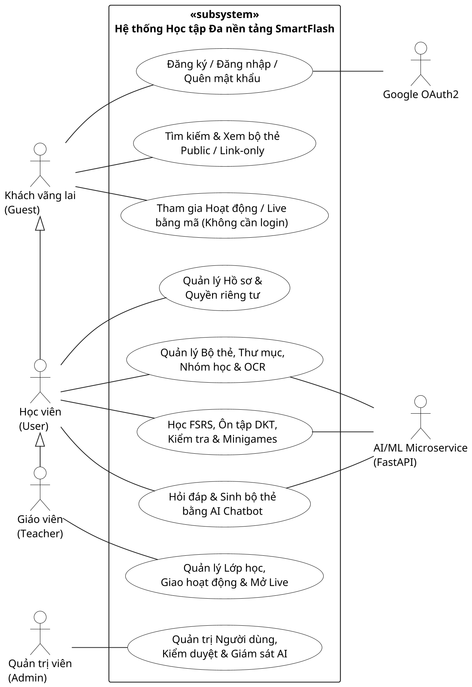

*Hình 2.2: Sơ đồ Use Case tổng quát của hệ thống SmartFlash*

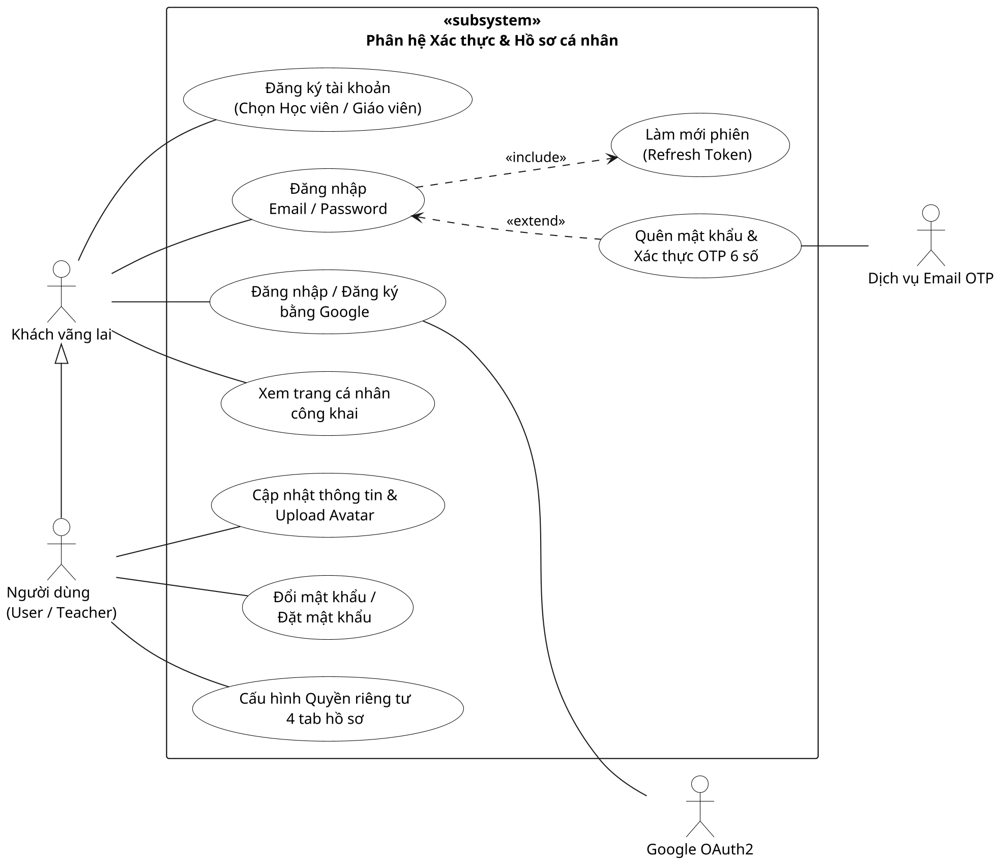

*Hình 2.3: Sơ đồ Use Case chi tiết phân hệ Xác thực và Hồ sơ cá nhân*

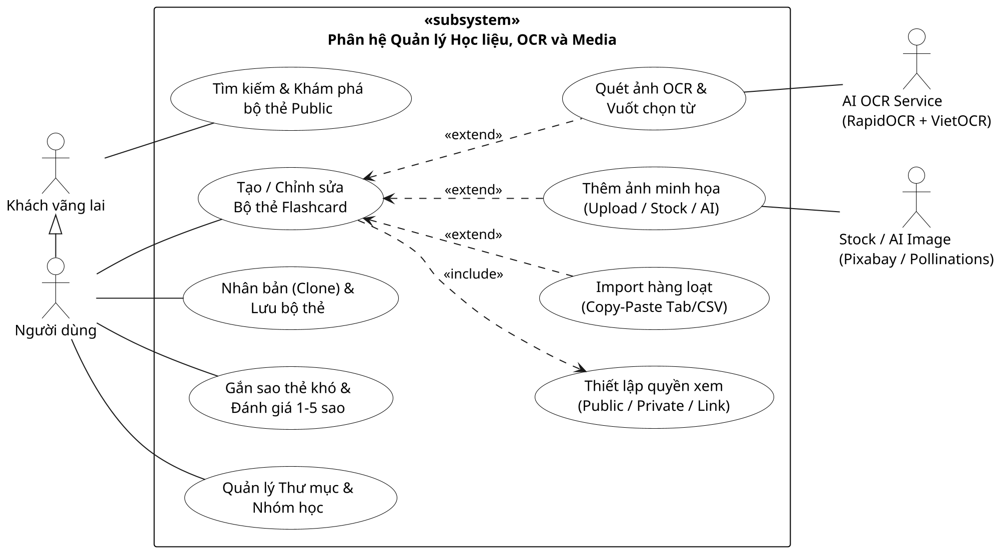

*Hình 2.4: Sơ đồ Use Case chi tiết phân hệ Quản lý học liệu, OCR và Media*

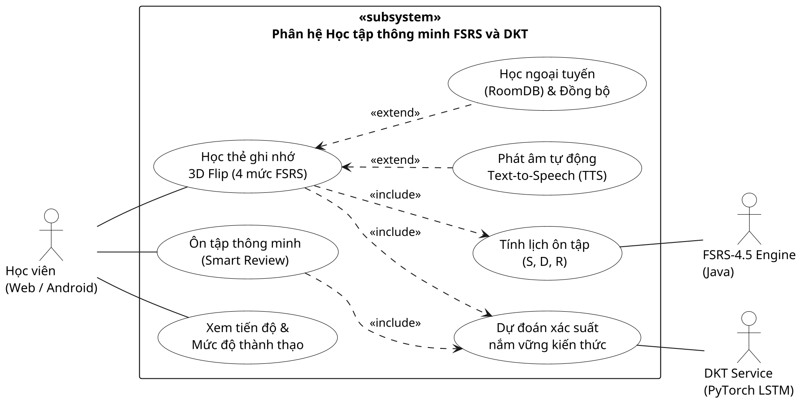

*Hình 2.5: Sơ đồ Use Case chi tiết phân hệ Học tập thông minh FSRS và DKT*

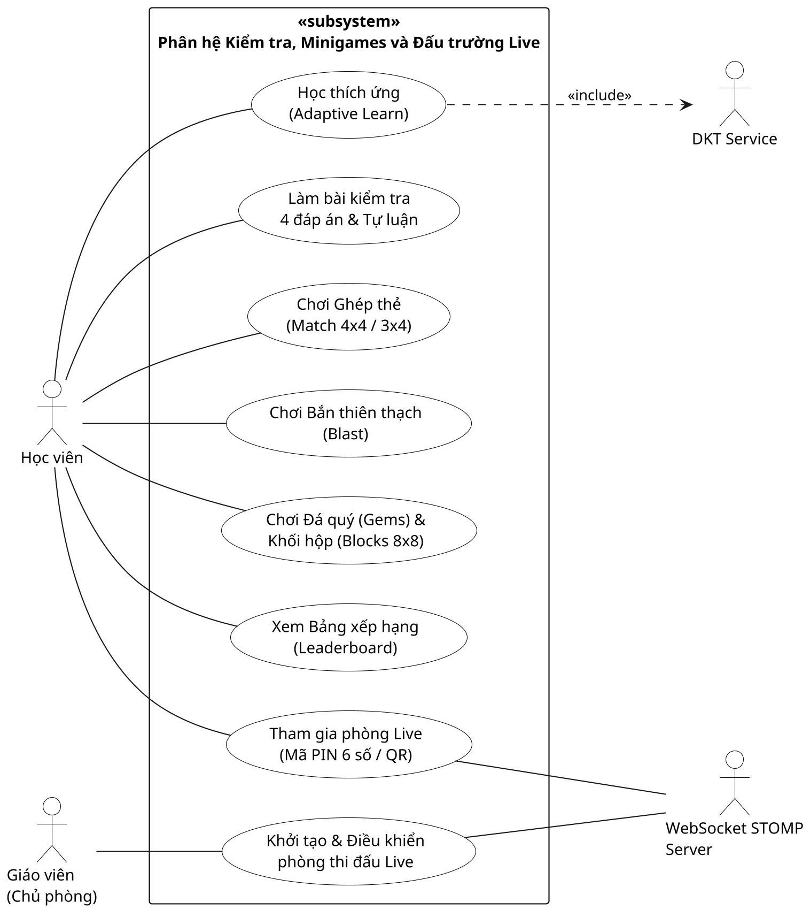

*Hình 2.6: Sơ đồ Use Case chi tiết phân hệ Kiểm tra, Minigames và Đấu trường Live*

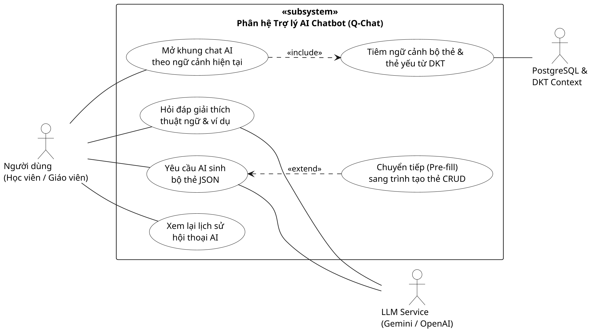

*Hình 2.7: Sơ đồ Use Case chi tiết phân hệ Trợ lý AI Chatbot (Q-Chat)*

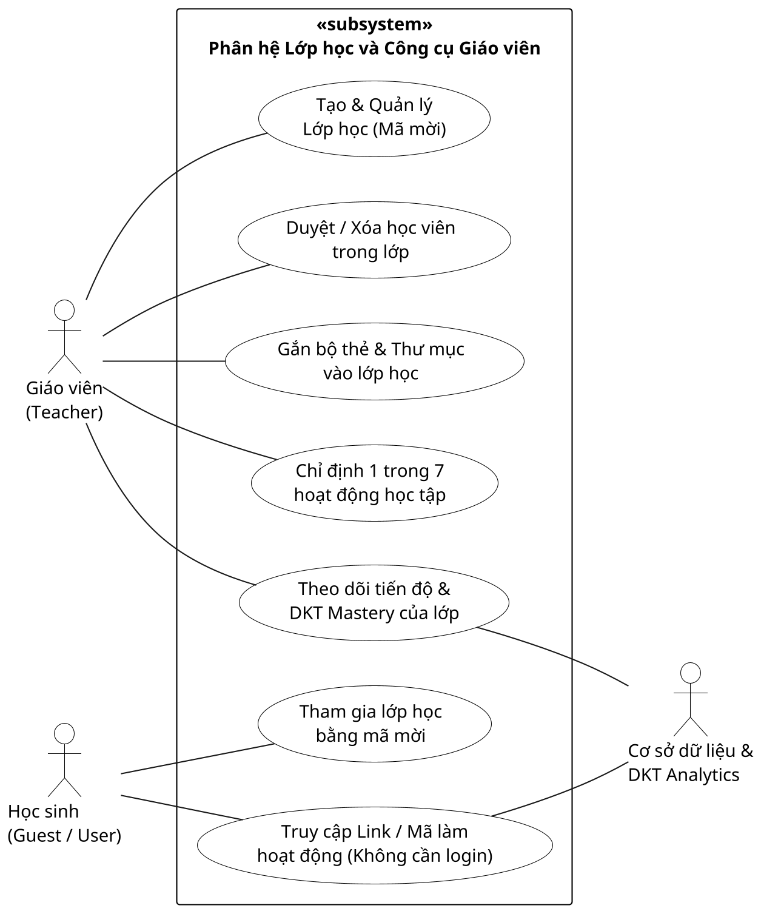

*Hình 2.8: Sơ đồ Use Case chi tiết phân hệ Lớp học và Công cụ Giáo viên*

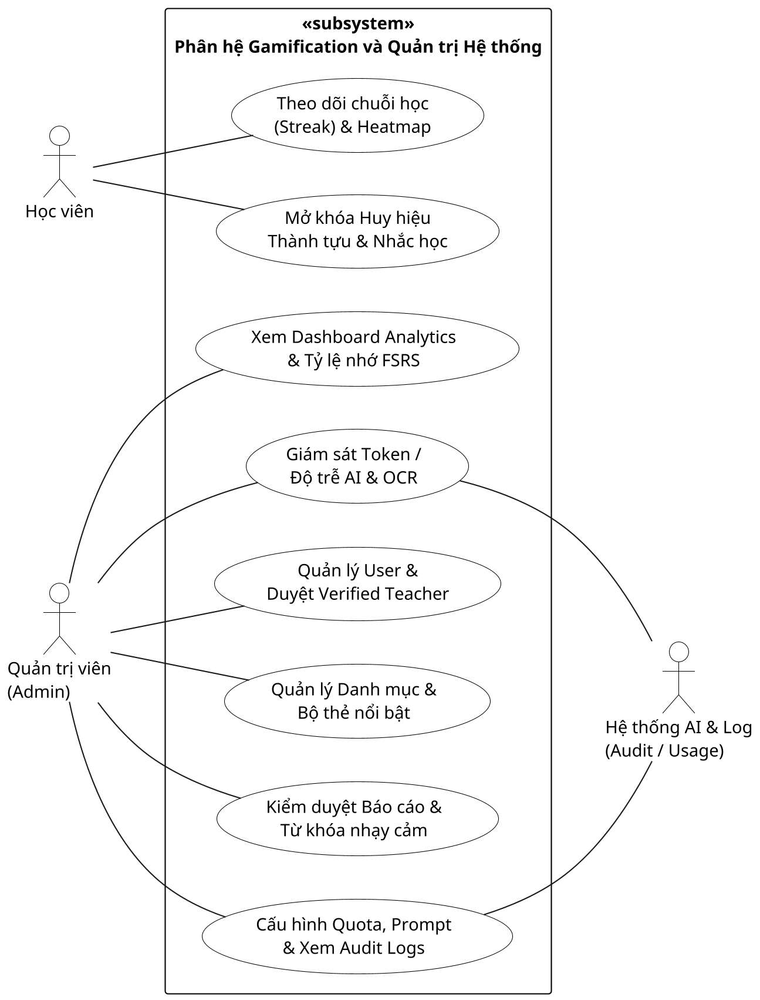

*Hình 2.9: Sơ đồ Use Case chi tiết phân hệ Gamification và Quản trị hệ thống*

#### 2.4.2 Bảng đặc tả các Use Case tiêu biểu

| Thuộc tính | Nội dung đặc tả |
| :--- | :--- |
| Mã và tên Use Case | UC-01: Đăng nhập hệ thống (Email/Password và Google OAuth2) |
| Tác nhân | Khách vãng lai (Guest), Google OAuth2 Service |
| Tiền điều kiện | Người dùng đang ở màn hình đăng nhập trên web hoặc Android; thiết bị có kết nối mạng. |
| Luồng sự kiện chính | 1. Người dùng nhập email hoặc username và mật khẩu, bấm đăng nhập hoặc chọn tiếp tục bằng Google. 2. Hệ thống gửi yêu cầu tới API đăng nhập hoặc xác thực Google kèm idToken. 3. Backend kiểm tra mật khẩu BCrypt hoặc xác thực chữ ký RS256 qua Google JWKS. 4. Nếu đăng nhập Google lần đầu, hệ thống tự động tạo tài khoản, liên kết oauth_accounts và khởi tạo chuỗi học. 5. Backend cấp accessToken và refreshToken để client lưu trữ và chuyển vào màn hình chính. |
| Luồng ngoại lệ | Sai thông tin đăng nhập trả về mã lỗi 401 kèm thông báo; tài khoản bị khóa tạm thời hoặc vĩnh viễn sẽ bị từ chối kèm lý do. |
| Hậu điều kiện | Người dùng được xác thực, mọi yêu cầu tiếp theo tự động đính kèm Bearer JWT. |

*Bảng 2.3: Đặc tả Use Case UC-01 — Đăng nhập hệ thống*

| Thuộc tính | Nội dung đặc tả |
| :--- | :--- |
| Mã và tên Use Case | UC-02: Quản lý quyền riêng tư trang cá nhân |
| Tác nhân | Người dùng đã đăng nhập |
| Tiền điều kiện | Người dùng đã đăng nhập và mở màn hình hồ sơ cá nhân trên web hoặc Android. |
| Luồng sự kiện chính | 1. Người dùng mở hộp thoại cài đặt quyền riêng tư. 2. Chọn mức hiển thị tổng thể gồm công khai, chỉ thành viên hoặc riêng tư. 3. Bật hoặc tắt quyền hiển thị riêng cho từng tab gồm bộ thẻ, thư mục, lớp học và thành tựu. 4. Hệ thống gửi yêu cầu cập nhật và lưu cấu hình vào trường JSONB trong bảng users. |
| Hậu điều kiện | Khi người khác xem trang cá nhân công khai, dữ liệu các tab bị ẩn sẽ được lọc bỏ từ tầng dịch vụ. |

*Bảng 2.4: Đặc tả Use Case UC-02 — Quản lý quyền riêng tư trang cá nhân*

| Thuộc tính | Nội dung đặc tả |
| :--- | :--- |
| Mã và tên Use Case | UC-03: Tạo mới và chỉnh sửa bộ thẻ Flashcard |
| Tác nhân | Người dùng đã đăng nhập |
| Tiền điều kiện | Người dùng mở trình biên tập bộ thẻ trên web hoặc Android. |
| Luồng sự kiện chính | 1. Người dùng nhập tiêu đề, mô tả, chọn danh mục, ngôn ngữ và chế độ hiển thị (công khai, riêng tư hoặc chỉ người có liên kết). 2. Nhập danh sách cặp thuật ngữ và định nghĩa, tùy chọn thêm ảnh minh họa hoặc nhập nhanh từ văn bản, ảnh OCR, dữ liệu chatbot. 3. Bấm lưu học phần để backend kiểm tra hợp lệ, tự sinh share_token nếu tạo mới và lưu đồng bộ bộ thẻ cùng danh sách thẻ con. |
| Luồng ngoại lệ | Thiếu tiêu đề hoặc số lượng thẻ ít hơn 2 sẽ hiển thị cảnh báo; bản nháp được tự động lưu tạm vào bộ nhớ trình duyệt để tránh mất dữ liệu. |
| Hậu điều kiện | Bộ thẻ mới được lưu vào cơ sở dữ liệu PostgreSQL và điều hướng về trang chi tiết bộ thẻ. |

*Bảng 2.5: Đặc tả Use Case UC-03 — Tạo mới và chỉnh sửa bộ thẻ Flashcard*

| Thuộc tính | Nội dung đặc tả |
| :--- | :--- |
| Mã và tên Use Case | UC-04: Trích xuất cặp thuật ngữ và định nghĩa từ ảnh |
| Tác nhân | Người dùng đã đăng nhập, dịch vụ AI OCR (FastAPI) |
| Tiền điều kiện | Người dùng đang ở trình biên tập bộ thẻ và mở chức năng quét ảnh OCR. |
| Luồng sự kiện chính | 1. Người dùng tải lên hoặc chụp ảnh tài liệu. 2. Client gửi ảnh tới endpoint OCR trên Spring Boot để chuyển tiếp sang FastAPI. 3. Dịch vụ AI cân chỉnh góc nghiêng, nhận diện văn bản bằng RapidOCR kết hợp VietOCR và tách cặp thuật ngữ định nghĩa kèm tọa độ từng từ. 4. Kết quả hiển thị lên giao diện để người dùng vuốt chọn trực tiếp trên ảnh hoặc chỉnh sửa rồi thêm vào bộ thẻ. |
| Luồng ngoại lệ | Ảnh vượt dung lượng hoặc dịch vụ AI không phản hồi sẽ trả về mã lỗi an toàn AI_503 mà không làm gián đoạn trình biên tập. |
| Hậu điều kiện | Các cặp thẻ trích xuất thành công được điền vào danh sách thẻ của trình biên tập. |

*Bảng 2.6: Đặc tả Use Case UC-04 — Trích xuất cặp thuật ngữ và định nghĩa từ ảnh*

| Thuộc tính | Nội dung đặc tả |
| :--- | :--- |
| Mã và tên Use Case | UC-05: Học thẻ thông minh theo lịch FSRS và DKT (Kế hoạch Phase 5) |
| Tác nhân | Học viên, lõi FSRS (Java), dịch vụ DKT (PyTorch LSTM) |
| Tiền điều kiện | Bộ thẻ có ít nhất 1 thẻ; người dùng chọn chế độ học thẻ ghi nhớ hoặc ôn tập thông minh. |
| Luồng sự kiện chính | 1. Hệ thống lấy danh sách thẻ đến hạn FSRS kết hợp các thẻ yếu từ DKT. 2. Người dùng lật thẻ và đánh giá mức độ nhớ theo 4 mức. 3. Spring Boot tính lại độ bền, độ khó và ngày ôn tiếp theo bằng FSRS-4.5 trong dưới 2 mili-giây và lưu giao dịch. 4. Tác vụ bất đồng bộ gửi chuỗi tương tác sang Python DKT để cập nhật xác suất nắm vững. |
| Luồng ngoại lệ | Nếu dịch vụ AI không phản hồi, hệ thống tự động chuyển về lịch ôn tập FSRS thuần. |
| Hậu điều kiện | Tiến độ thẻ và chuỗi ngày học được cập nhật chính xác. |

*Bảng 2.7: Đặc tả Use Case UC-05 — Học thẻ thông minh theo lịch FSRS và DKT*

| Thuộc tính | Nội dung đặc tả |
| :--- | :--- |
| Mã và tên Use Case | UC-06: Giáo viên chỉ định hoạt động không cần đăng nhập (Kế hoạch Phase 7) |
| Tác nhân | Giáo viên, học sinh (không bắt buộc tài khoản) |
| Tiền điều kiện | Giáo viên đã tạo bộ thẻ hoặc lớp học. |
| Luồng sự kiện chính | 1. Giáo viên mở hộp thoại giao hoạt động, chọn 1 trong 7 loại hoạt động, đặt hạn chót và nhận mã tham gia kèm liên kết. 2. Học sinh truy cập liên kết, nhập họ tên để làm bài ngay mà không cần đăng nhập. 3. Tiến độ và điểm số được cập nhật trực tiếp lên bảng theo dõi của giáo viên. |
| Hậu điều kiện | Giáo viên xem được danh sách hoàn thành, điểm số và các thuật ngữ lớp hay trả lời sai. |

*Bảng 2.8: Đặc tả Use Case UC-06 — Giáo viên chỉ định hoạt động không cần đăng nhập*

### 2.5 Kiến trúc tổng thể và các sơ đồ luồng xử lý

Hệ thống áp dụng kiến trúc Hybrid Modular Monolith (Spring Boot 3.x) kết hợp AI/ML Microservice (Python FastAPI). Cách tiếp cận này giúp đảm bảo giao dịch ACID cho toàn bộ nghiệp vụ quản lý và học tập trên một cơ sở dữ liệu PostgreSQL duy nhất, đồng thời tách riêng các tác vụ tính toán ma trận nặng như DKT, OCR và LLM sang hệ sinh thái Python.

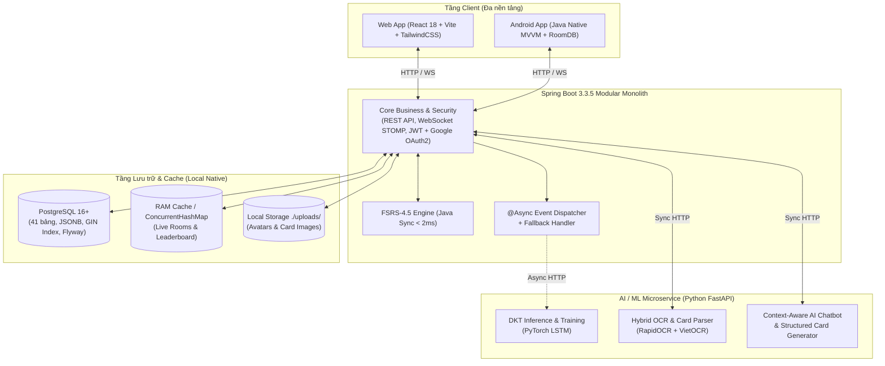

*Hình 2.10: Sơ đồ kiến trúc tổng thể hệ thống*

Để làm rõ sự phối hợp giữa các tầng phần mềm, bốn sơ đồ luồng xử lý trọng tâm dưới đây mô tả chi tiết luồng xác thực tập trung, luồng trích xuất OCR, luồng học tập bất đồng bộ FSRS kết hợp DKT và luồng chuyển tiếp dữ liệu từ chatbot sang trình biên tập.

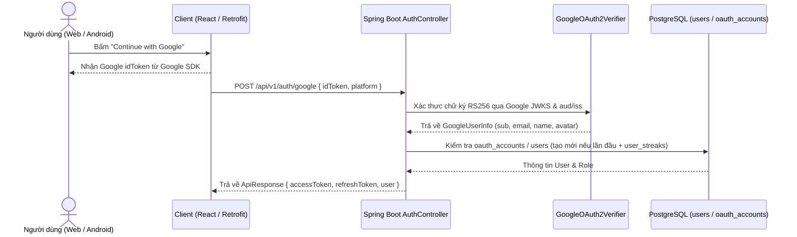

*Hình 2.11: Sơ đồ luồng xác thực tập trung (JWT và Google OAuth2)*

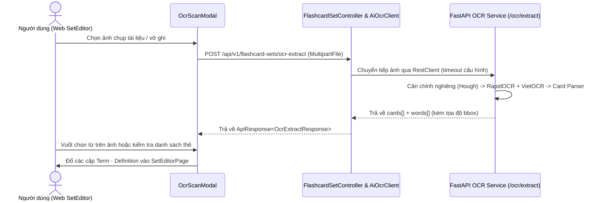

*Hình 2.12: Sơ đồ luồng trích xuất thẻ từ ảnh chụp tài liệu (OCR Pipeline)*

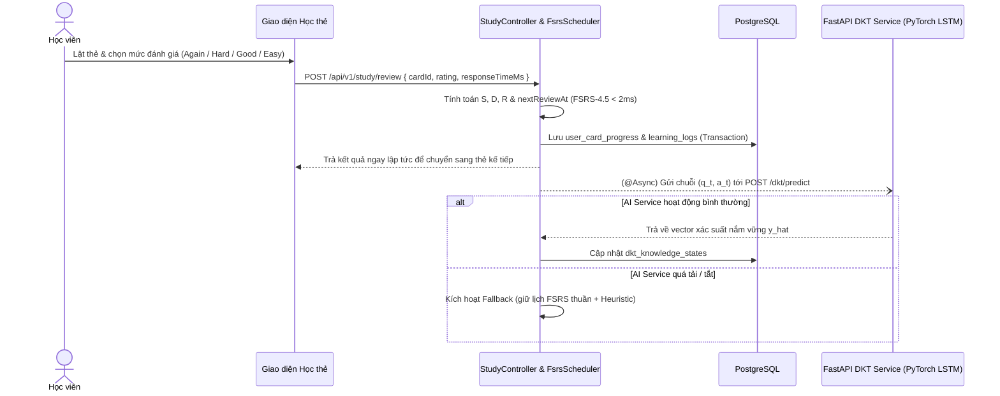

*Hình 2.13: Sơ đồ luồng học tập bất đồng bộ kết hợp FSRS-4.5 và DKT*

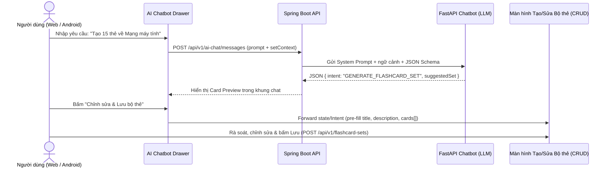

*Hình 2.14: Sơ đồ luồng AI Chatbot tạo bộ thẻ và chuyển tiếp sang màn hình CRUD*

### 2.6 Thiết kế cơ sở dữ liệu (PostgreSQL 16+)

Cơ sở dữ liệu smartflash_db được thiết kế khép kín gồm 41 bảng chia thành 8 phân hệ và được quản lý chặt chẽ thông qua 3 file Flyway Migration (V1, V2, V3) để đảm bảo tính đồng bộ lược đồ ngay khi khởi động Spring Boot.

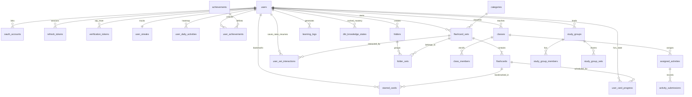

*Hình 2.15: Sơ đồ quan hệ thực thể tổng thể (ERD) của cơ sở dữ liệu PostgreSQL*

| File Migration | Phân hệ | Số bảng | Các bảng tiêu biểu |
| :--- | :--- | :---: | :--- |
| V1__init_core_users_and_cards.sql | Danh mục, Người dùng, Auth và Học liệu | 11 | categories, users, oauth_accounts, refresh_tokens, verification_tokens, flashcard_sets, flashcards, user_set_interactions, starred_cards, folders, folder_sets |
| V2__init_study_and_activities.sql | Học tập FSRS/DKT, Kiểm tra, Game và Lớp học | 14 | user_card_progress, learning_logs, ai_model_versions, dkt_knowledge_states, test_attempts, game_scores, live_game_rooms, live_game_participants, classes, class_members, class_sets, class_folders, assigned_activities, activity_submissions |
| V3__init_gamification_chat_admin_and_indexes.sql | Nhóm học, Gamification, AI Chat và Quản trị | 16 | study_groups, study_group_members, study_group_sets, user_streaks, user_daily_activities, achievements, user_achievements, ai_chat_sessions, ai_chat_messages, teacher_verification_requests, content_reports, sensitive_keywords, ai_usage_logs, system_settings, system_announcements, user_notifications, admin_audit_logs |

*Bảng 2.9: Tổng hợp cấu trúc cơ sở dữ liệu PostgreSQL qua 3 file Flyway Migration*

| Tên bảng | Cột khóa và thuộc tính trọng tâm | Mục đích và thiết kế đặc thù |
| :--- | :--- | :--- |
| users | id (PK), username, email, password_hash, role, status, profile_visibility, profile_privacy_config (JSONB), fsrs_weights (JSONB) | Lưu tài khoản đa vai trò; sử dụng JSONB để cấu hình bật/tắt 4 tab trang cá nhân linh hoạt và lưu bộ tham số FSRS riêng. |
| flashcard_sets | id (PK), owner_id (FK), category_id (FK), title, visibility, share_token, source_type, avg_rating, card_count, deleted_at | Hỗ trợ xóa mềm (deleted_at), kiểm soát quyền xem 3 mức (PUBLIC, PRIVATE, LINK_ONLY qua share_token NanoID 12 ký tự). |
| flashcards | id (PK), set_id (FK), term, definition, example_sentence, image_url, position | Lưu từng cặp thẻ thuộc bộ thẻ; hỗ trợ ảnh minh họa từ tải lên, kho ảnh miễn phí hoặc tạo bằng AI. |
| user_set_interactions | (user_id, set_id) (PK), is_saved, rating, last_studied_at, resume_state_json (JSONB) | Một bảng hợp nhất xử lý bộ thẻ đã lưu, học gần đây, đánh giá 1 đến 5 sao và đồng bộ vị trí học dở giữa web và Android. |

*Bảng 2.10: Đặc tả chi tiết một số bảng cốt lõi đã triển khai*

---
<!-- NGẮT TRANG (PAGE BREAK) -->
---

## CHƯƠNG 3. KẾT QUẢ TRIỂN KHAI TIẾN ĐỘ LẦN 1 VÀ KIỂM THỬ

### 3.1 Tổng quan tiến độ thực hiện đến thời điểm kiểm tra lần 1

Toàn bộ lộ trình phát triển hệ thống được chia nhỏ thành 8 giai đoạn (Phase) với 66 công việc nguyên tử (từ T1.1 đến T8.9). Tính đến thời điểm báo cáo tiến độ lần 1, dự án đã hoàn thành 27 trên 66 công việc (đạt 40,9 phần trăm khối lượng toàn dự án), bao gồm toàn bộ Phase 1, toàn bộ Phase 2 và 9 trên 12 công việc của Phase 3.

| Phase | Nội dung chính | Tiến độ | Trạng thái |
| :--- | :--- | :---: | :--- |
| Phase 1 | Khởi tạo monorepo, 3 file Flyway PostgreSQL, gói common Spring Boot, khung FastAPI, React và Android MVVM | 9 / 9 (T1.1 – T1.9) | Hoàn thành |
| Phase 2 | Xác thực (JWT, Google OAuth2 ID Token, OTP), RBAC 4 vai trò, hồ sơ cá nhân và quyền riêng tư 4 tab trên BE, Web và Android | 9 / 9 (T2.1 – T2.9) | Hoàn thành |
| Phase 3 | CRUD bộ thẻ, quyền xem, tìm kiếm, clone, tương tác, thư mục, nhóm học, pipeline OCR lai, Media AI/Stock và Web Explore/Library/SetEditor/SetDetail | 9 / 12 (T3.1 – T3.9) | Đang thực hiện (còn T3.10 – T3.12 trên Android) |
| Phase 4 | AI Chatbot tùy biến ngữ cảnh và chuyển tiếp JSON sang CRUD | 0 / 4 | Kế hoạch tiếp theo |
| Phase 5 | Lõi học tập FSRS-4.5 (Java) và Deep Knowledge Tracing (PyTorch LSTM) kèm Offline RoomDB | 0 / 6 | Kế hoạch tiếp theo |
| Phase 6 | Kiểm tra, Adaptive Learn, 4 Minigames và đấu trường Live WebSocket STOMP | 0 / 10 | Kế hoạch tiếp theo |
| Phase 7 | Lớp học, chỉ định 7 hoạt động không cần đăng nhập và báo cáo giáo viên | 0 / 7 | Kế hoạch tiếp theo |
| Phase 8 | Gamification (Streak, thành tựu), Admin Portal (7 nhóm chức năng) và Data Seeder | 0 / 9 | Kế hoạch tiếp theo |

*Bảng 3.1: Bảng theo dõi tiến độ thực hiện đồ án theo từng Phase*

### 3.2 Kết quả triển khai Backend và cơ sở dữ liệu

Tại Backend Spring Boot 3.3.5, các phân hệ nền tảng, xác thực và quản lý học liệu đã được xây dựng hoàn chỉnh theo chuẩn kiến trúc Modular Monolith. Ở tầng dùng chung, hệ thống đã chuẩn hóa lớp BaseEntity, cấu trúc phản hồi ApiResponse và PageResponse, bộ xử lý ngoại lệ tập trung GlobalExceptionHandler cùng cấu hình phục vụ tệp ảnh tĩnh tại đường dẫn cục bộ.

Ở phân hệ bảo mật và hồ sơ người dùng, Spring Security 6 đã được cấu hình với JwtTokenProvider và bộ lọc phân quyền cho 4 vai trò. Lớp GoogleOAuth2Verifier xác thực idToken RS256 thông qua Google JWKS để dùng chung cho cả trình duyệt web và ứng dụng Android. Bên cạnh đó, UserService và ProfileTabDataLoader hỗ trợ tải ảnh đại diện, đổi hoặc đặt mật khẩu và lọc dữ liệu 4 tab trang cá nhân theo đúng cấu hình quyền riêng tư.

Ở phân hệ học liệu, FlashcardSetService xử lý lưu đồng bộ bộ thẻ cùng danh sách thẻ con, tự sinh share_token 12 ký tự và kiểm tra chặt chẽ ba mức quyền xem. Các API tìm kiếm, khám phá, nhân bản bộ thẻ, tương tác lưu hoặc đánh giá, gắn sao thẻ khó, quản lý thư mục và nhóm học đều đã hoàn thiện. Đồng thời, AiOcrClient kết nối tới dịch vụ OCR với cơ chế dự phòng lỗi an toàn, còn MediaService hỗ trợ tải ảnh thẻ, tìm ảnh miễn phí từ Pixabay hoặc Unsplash và tạo ảnh minh họa bằng Pollinations.

| Nhóm API | Các endpoints tiêu biểu đã hoàn thiện | Ghi chú |
| :--- | :--- | :--- |
| Auth | POST /api/v1/auth/register, /login, /google, /forgot-password, /reset-password, /refresh, /logout | Tích hợp OTP 6 số và Google OAuth2 |
| User và Profile | GET/PUT /api/v1/users/me, POST /me/avatar, PUT /me/password, PUT /me/privacy, GET /profile/{username} | Hỗ trợ lọc quyền riêng tư 4 tab |
| Flashcard Sets | POST/PUT/DELETE /api/v1/flashcard-sets, GET /my, GET /{id}, GET /share/{token}, GET /explore, GET /search, POST /{id}/clone, POST /ocr-extract | Kiểm soát 3 mức quyền xem và OCR |
| Interactions | POST/DELETE /{id}/save, GET /saved, GET /recents, PUT /{id}/resume, POST /{id}/rate, POST/DELETE /{id}/cards/{cardId}/star | Lưu vết học dở và đánh giá 1 đến 5 sao |
| Folders và Groups | /api/v1/folders/** (CRUD, gắn/gỡ bộ thẻ), /api/v1/study-groups/** (tạo nhóm, invite_code, join, chia sẻ bộ thẻ) | Đầy đủ quyền chia sẻ và thành viên |
| Media | POST /api/v1/media/upload, GET /api/v1/media/stock-search, POST /api/v1/media/ai-generate | Pixabay/Unsplash và Pollinations AI |

*Bảng 3.2: Danh sách các nhóm API đã hoàn thiện và kiểm thử ở Phase 2 và Phase 3*

### 3.3 Kết quả triển khai dịch vụ AI/ML

Dịch vụ ai-ml-service xây dựng bằng Python FastAPI đã hoàn thiện khung cấu trúc gồm các router cho DKT, OCR, chatbot và kiểm tra trạng thái hệ thống. Trọng tâm đã triển khai trong đợt này là pipeline OCR lai và bộ phân tích thẻ (Card Parser).

Ảnh đầu vào sau khi kiểm tra định dạng và dung lượng sẽ được cân chỉnh góc nghiêng bằng biến đổi Hough, sau đó đi qua pipeline kết hợp RapidOCR để xác định vùng chữ cùng tọa độ từng từ và VietOCR để tăng cường độ chính xác dấu tiếng Việt. Cuối cùng, Card Parser tự động bóc tách các cặp thuật ngữ và định nghĩa dựa trên các dấu phân cách phổ biến và hỗ trợ cơ chế dự phòng an toàn khi thiếu cấu hình.

### 3.4 Kết quả triển khai giao diện Web

Giao diện web xây dựng bằng React 18, Vite và TailwindCSS đã hoàn thiện các luồng màn hình chính của Phase 2 và Phase 3. Đối với luồng xác thực và điều hướng, LoginPage và RegisterPage áp dụng bố cục hai cột, tích hợp nút đăng nhập Google, luồng quên mật khẩu OTP 6 số, chọn vai trò khi đăng ký và bảo vệ đường dẫn theo vai trò qua ProtectedRoute. Thành phần MainLayout cung cấp thanh điều hướng trái thu gọn, thanh tìm kiếm nhanh theo tên người dùng và cơ chế tự động xoay vòng refresh token trong axiosClient.

Đối với luồng khám phá và quản lý thư viện, LandingExplorePage cho phép cả khách và người dùng tìm kiếm bộ thẻ công khai, lọc theo danh mục và sắp xếp theo tiêu chí. LibraryPage tổ chức học liệu cá nhân thành bốn tab gồm bộ thẻ của tôi, đã lưu và gần đây, thư mục và nhóm học cùng các hộp thoại tạo mới hoặc tham gia bằng mã mời.

Đối với trình biên tập học liệu, SetEditorPage hỗ trợ thanh công cụ ghim đầu trang khi cuộn, tự động lưu và khôi phục bản nháp tạm thời trong localStorage, chỉnh quyền xem và chọn ảnh minh họa trực tiếp trên từng dòng thẻ. BulkImportModal hỗ trợ dán văn bản hàng loạt để tách thẻ tức thì, trong khi OcrScanModal cho phép tải ảnh lên và dùng chuột vuốt chọn trực tiếp các từ trên ảnh dựa trên khung tọa độ trả về từ dịch vụ OCR.

Đối với màn hình chi tiết bộ thẻ và hồ sơ cá nhân, SetDetailPage tích hợp bộ thẻ lật 3D hỗ trợ phím tắt, phát âm tự động bằng Web Speech API, gắn sao thẻ khó, nhân bản bộ thẻ, sao chép liên kết chia sẻ, đánh giá 1 đến 5 sao và bảng chọn 8 chế độ học. Trang UserProfilePage hiển thị 4 tab dữ liệu kèm hộp thoại ProfilePrivacyModal cho phép cấu hình ẩn hiện từng tab.

### 3.5 Kết quả triển khai ứng dụng di động Android

Ứng dụng Android Native bằng Java theo kiến trúc MVVM đã hoàn thiện toàn bộ các hạng mục của Phase 1 và Phase 2. Ở tầng dữ liệu và mạng, RetrofitClient được tích hợp AuthInterceptor để tự động đính kèm Bearer JWT và TokenAuthenticator để tự động làm mới token khi gặp lỗi 401, kết hợp lưu trữ an toàn qua TokenManager.

Ở tầng giao diện, các màn hình SplashActivity, LoginActivity (hỗ trợ email, Google Sign-In, quên mật khẩu OTP 6 số và chế độ khách) và RegisterActivity đã vận hành ổn định. Màn hình chính MainActivity sử dụng BottomNavigationView với bốn tab điều hướng, trong đó ProfileFragment hỗ trợ cập nhật thông tin cá nhân, tải ảnh đại diện, đổi mật khẩu và cấu hình quyền riêng tư trang cá nhân.

### 3.6 Kết quả kiểm thử hệ thống

Toàn bộ các thành phần đã hoàn thiện đều trải qua bước kiểm thử đơn vị, kiểm thử tích hợp và kiểm tra biên dịch trước khi xác nhận hoàn thành từng công việc. Chi tiết phạm vi và kết quả kiểm thử được tổng hợp trong Bảng 3.3.

| Thành phần | Công cụ kiểm thử | Phạm vi kiểm thử đã thực hiện | Kết quả |
| :--- | :--- | :--- | :---: |
| Dịch vụ AI/ML | pytest | Kiểm thử endpoint /health, cấu hình router và pipeline OCR cùng Card Parser trong test_ocr.py | Đạt 12/12 test |
| Backend Spring Boot | JUnit 5, Spring Boot Test, MockMvc | Kiểm thử JwtTokenProvider, GoogleOAuth2Verifier, AuthService, UserProfile, FlashcardSet CRUD và Visibility, Explore/Clone/Interactions, Folder/StudyGroup, AiOcrClient và MediaController | Biên dịch và chạy test xanh trong IntelliJ IDEA |
| Giao diện Web | Vite Build (npm run build) | Kiểm tra cú pháp, import và đóng gói toàn bộ trang, component và routing từ T1.8 đến T3.9 | Build thành công (13,67 giây sau T3.9) |
| Ứng dụng Android | Gradle assembleDebug, JUnit | Kiểm tra biên dịch XML/Java, AndroidManifest và ProfileUtilsTest cho Phase 2 | Build Debug và Unit Test thành công |

*Bảng 3.3: Bảng tổng hợp kết quả kiểm thử hệ thống đến đợt tiến độ lần 1*

---
<!-- NGẮT TRANG (PAGE BREAK) -->
---

## KẾT LUẬN VÀ HƯỚNG PHÁT TRIỂN

### 1. Kết quả đạt được
Đến thời điểm kiểm tra tiến độ đồ án lần 1, dự án SmartFlash đã hoàn thành 27 trên 66 công việc (đạt 40,9 phần trăm khối lượng), thiết lập vững chắc nền tảng kỹ thuật cho toàn bộ hệ thống. Trước hết, kiến trúc tổng thể và thiết kế 41 bảng cơ sở dữ liệu PostgreSQL qua 3 file Flyway Migration đã được hoàn thiện và kiểm chứng, đảm bảo tính ổn định cho các giai đoạn phát triển tiếp theo.

Bên cạnh đó, hệ thống xác thực và quản lý hồ sơ đa nền tảng đã vận hành đồng bộ trên cả Spring Boot, React Web và Android Java, hỗ trợ đầy đủ đăng nhập truyền thống, OTP quên mật khẩu, Google OAuth2 và phân quyền riêng tư chi tiết theo từng tab. Lõi quản lý học liệu cùng pipeline OCR lai (RapidOCR kết hợp VietOCR) cũng đã hoàn thiện phía backend, AI service và giao diện web, cho phép người dùng tạo, chia sẻ, nhân bản và quét ảnh tách thẻ trực tiếp.

### 2. Những hạn chế còn tồn tại
Về tiến độ trên nền tảng di động, ba công việc cuối của Phase 3 trên Android gồm màn hình danh sách học liệu (T3.10), trình tạo sửa thẻ tích hợp CameraX OCR (T3.11) và màn hình chi tiết bộ thẻ tích hợp phát âm Android TTS (T3.12) hiện đang trong danh sách chuẩn bị triển khai để theo kịp tiến độ giao diện web.

Về các phân hệ lõi học thuật và tương tác nâng cao, mô-đun AI Chatbot (Phase 4), thuật toán lập lịch FSRS-4.5 kết hợp mạng nơ-ron DKT (Phase 5), các trò chơi và đấu trường trực tuyến WebSocket (Phase 6), phân hệ lớp học giáo viên (Phase 7) và cổng quản trị viên (Phase 8) sẽ được tập trung xây dựng trong giai đoạn tiếp theo sau đợt kiểm tra lần 1.

### 3. Kế hoạch triển khai các giai đoạn tiếp theo
Trong giai đoạn tiếp theo, kế hoạch thực hiện tập trung vào ba bước chính. Trong ngắn hạn, em sẽ hoàn thiện T3.10 đến T3.12 trên ứng dụng Android Native để đồng bộ hoàn toàn các chức năng quản lý học liệu giữa web và di động. Trong trung hạn, em sẽ triển khai Phase 4 (AI Chatbot theo ngữ cảnh có nút chuyển tiếp sang trình biên tập) và Phase 5 (cài đặt thuật toán FSRS-4.5 bằng Java kết hợp huấn luyện mô hình PyTorch LSTM cho DKT cùng đồng bộ ngoại tuyến RoomDB trên Android). Cuối cùng, em sẽ hoàn thiện Phase 6, Phase 7 và Phase 8 cùng kịch bản dữ liệu mẫu để phục vụ kiểm thử toàn diện và bảo vệ đồ án.

---
<!-- NGẮT TRANG (PAGE BREAK) -->
---

## TÀI LIỆU THAM KHẢO

[1] Ye, J., et al. (2022–2024). FSRS: Free Spaced Repetition Scheduler (FSRS-4.5 Algorithm and DSR Model Documentation). Open Spaced Repetition.  
[2] Piech, C., Bassen, J., Huang, J., Ganguli, S., Sahami, M., Guibas, L. J., & Sohl-Dickstein, J. (2015). Deep Knowledge Tracing. Advances in Neural Information Processing Systems (NeurIPS), 28.  
[3] Walls, C. (2022). Spring in Action (6th ed.). Manning Publications.  
[4] Silberschatz, A., Korth, H. F., & Sudarshan, S. (2019). Database System Concepts (7th ed.). McGraw-Hill.  
[5] Paszke, A., et al. (2019). PyTorch: An Imperative Style, High-Performance Deep Learning Library. Advances in Neural Information Processing Systems (NeurIPS), 32.  
[6] Tài liệu kỹ thuật chính thức của Spring Boot 3.x, Spring Security 6, PostgreSQL 16, Flyway, FastAPI, React 18 và Android Developers (Jetpack Room, CameraX, WorkManager).
