# Thiết kế Cơ sở Dữ liệu Chi tiết (PostgreSQL)

Tài liệu này mô tả chi tiết cấu trúc Cơ sở dữ liệu cho hệ thống **SmartFlash – Hệ thống học tập đa nền tảng cá nhân hóa (Spring Boot + React + Android Java + Python AI)**.

- **Hệ quản trị CSDL (DBMS)**: **PostgreSQL 16+**
- **Công cụ quản lý Migration**: Flyway (`backend-springboot/src/main/resources/db/migration/V1__init_schema.sql`)
- **ORM trên Spring Boot**: Spring Data JPA / Hibernate 6
- **Local DB trên Android (Offline Sync)**: Room Database (SQLite) ánh xạ các bảng cốt lõi (`flashcard_sets`, `flashcards`, `user_card_progress`, `offline_review_queue`).

---

## 1. Quy ước Chung (Database Conventions)

1. **Quy tắc đặt tên (Naming Conventions)**:
   - Tên bảng: `snake_case`, số nhiều (ví dụ: `users`, `flashcard_sets`, `assigned_activities`).
   - Tên cột: `snake_case`, số ít (ví dụ: `user_id`, `next_review_at`, `share_token`).
   - Khóa chính (Primary Key): Thống nhất dùng `id BIGSERIAL PRIMARY KEY` (tương ứng `Long` trong Java) để tối ưu tốc độ Index B-Tree và tiết kiệm bộ nhớ khi join lượng lớn `learning_logs`. Với các mã chia sẻ công khai ra URL (tránh lộ ID tuần tự), sử dụng cột `public_id UUID DEFAULT gen_random_uuid()` hoặc `share_token VARCHAR(32)`.
   - Khóa ngoại (Foreign Key): Đặt tên theo mẫu `<tên_bảng_tham_chiếu_số_ít>_id` (ví dụ: `user_id`, `set_id`, `class_id`). Index bắt buộc trên mọi cột FK.
2. **Các cột Audit tiêu chuẩn (Standard Audit Columns)**:
   - Mọi bảng nghiệp vụ chính đều kế thừa `BaseEntity` gồm:
     - `created_at TIMESTAMPTZ NOT NULL DEFAULT CURRENT_TIMESTAMP`
     - `updated_at TIMESTAMPTZ NOT NULL DEFAULT CURRENT_TIMESTAMP`
   - Các bảng cần xóa mềm (Soft Delete) như `users`, `flashcard_sets`, `classes` có thêm:
     - `deleted_at TIMESTAMPTZ NULL` (nếu `NULL` là đang hoạt động).
3. **Kiểu dữ liệu đặc thù của PostgreSQL được tận dụng**:
   - `TIMESTAMPTZ` (`TIMESTAMP WITH TIME ZONE`): Lưu chuẩn UTC để đồng bộ chính xác thời điểm ôn tập FSRS và chuỗi ngày học (Streak) giữa Web và Android.
   - `JSONB`: Lưu trữ linh hoạt các cấu trúc động như cấu hình quyền riêng tư từng tab trang cá nhân (`profile_privacy_config`), dữ liệu đề bài snapshot, hoặc metadata kết quả AI/OCR.
   - `GIN Index` + `tsvector` / `pg_trgm`: Tăng tốc tìm kiếm toàn văn (Full-text search) cho tiêu đề và mô tả bộ thẻ.

---

## 2. Sơ đồ Quan hệ Thực thể Tổng thể (ERD)

```mermaid
erDiagram
    users ||--o{ oauth_accounts : links
    users ||--o{ refresh_tokens : sessions
    users ||--o{ verification_tokens : otp_reset
    users ||--|| user_streaks : tracks
    users ||--o{ user_daily_activities : heatmap
    users ||--o{ user_achievements : unlocks
    achievements ||--o{ user_achievements : defines

    users ||--o{ flashcard_sets : owns
    flashcard_sets ||--|{ flashcards : contains
    users ||--o{ user_set_interactions : saves_rates_resumes
    flashcard_sets ||--o{ user_set_interactions : interacted_by
    users ||--o{ starred_cards : bookmarks
    flashcards ||--o{ starred_cards : bookmarked_in

    users ||--o{ folders : creates
    folders ||--o{ folder_sets : groups
    flashcard_sets ||--o{ folder_sets : belongs_to

    users ||--o{ user_card_progress : fsrs_state
    flashcards ||--o{ user_card_progress : scheduled_for
    users ||--o{ learning_logs : generates
    flashcards ||--o{ learning_logs : logged_in
    users ||--o{ dkt_knowledge_states : cached_mastery
    ai_model_versions ||--o{ dkt_knowledge_states : predicts

    users ||--o{ classes : teaches
    classes ||--o{ class_members : enrolls
    classes ||--o{ class_sets : includes
    classes ||--o{ class_folders : includes_folders
    classes ||--o{ assigned_activities : assigns
    flashcard_sets ||--o{ assigned_activities : used_in
    assigned_activities ||--o{ activity_submissions : records

    flashcard_sets ||--o{ test_attempts : tested_in
    flashcard_sets ||--o{ game_scores : leaderboard
    flashcard_sets ||--o{ live_game_rooms : hosts
    live_game_rooms ||--o{ live_game_participants : joins

    users ||--o{ study_groups : leads
    study_groups ||--o{ study_group_members : has
    study_groups ||--o{ study_group_sets : shares

    users ||--o{ ai_chat_sessions : chats
    ai_chat_sessions ||--o{ ai_chat_messages : has

    categories ||--o{ categories : parent_of
    categories ||--o{ flashcard_sets : classifies
    users ||--o{ teacher_verification_requests : requests
    users ||--o{ content_reports : submits
    users ||--o{ ai_usage_logs : consumes
    users ||--o{ admin_audit_logs : performs
    users ||--o{ system_announcements : publishes
    users ||--o{ user_notifications : receives
```



---

## 3. Chi tiết Các Bảng theo Phân hệ (Schema Specification)

### Phân hệ 1: Người dùng, Phân quyền & Quyền riêng tư Trang cá nhân (`auth` & `user`)

#### 3.1. Bảng `users`
Lưu thông tin tài khoản cho cả 4 vai trò (`USER`, `TEACHER`, `ADMIN`; khách vãng lai không lưu trong bảng này).

| Tên cột | Kiểu dữ liệu (PostgreSQL) | Ràng buộc | Mô tả |
| :--- | :--- | :--- | :--- |
| `id` | `BIGSERIAL` | `PRIMARY KEY` | Định danh duy nhất của người dùng |
| `username` | `VARCHAR(50)` | `UNIQUE NOT NULL` | Tên định danh trên URL trang cá nhân (`/users/:username`) |
| `email` | `VARCHAR(150)` | `UNIQUE NOT NULL` | Email đăng nhập |
| `password_hash` | `VARCHAR(255)` | `NULL` | Mật khẩu mã hóa BCrypt (`NULL` nếu chỉ đăng nhập qua Google) |
| `full_name` | `VARCHAR(100)` | `NOT NULL` | Họ và tên hiển thị |
| `avatar_url` | `TEXT` | `NULL` | Đường dẫn ảnh đại diện (MinIO/Cloudinary/Google) |
| `bio` | `VARCHAR(500)` | `NULL` | Giới thiệu ngắn trên trang cá nhân |
| `role` | `VARCHAR(20)` | `NOT NULL DEFAULT 'USER'` | Vai trò: `'USER'`, `'TEACHER'`, `'ADMIN'` |
| `is_verified_teacher` | `BOOLEAN` | `NOT NULL DEFAULT FALSE` | Huy hiệu **Verified Teacher / Creator** (giống tích xác minh của Quizlet sau khi Admin duyệt) |
| `status` | `VARCHAR(20)` | `NOT NULL DEFAULT 'ACTIVE'` | Trạng thái: `'ACTIVE'`, `'SUSPENDED'`, `'BANNED'`, `'PENDING_VERIFICATION'` |
| `suspended_until` | `TIMESTAMPTZ` | `NULL` | Thời hạn khóa tạm thời (nếu Admin khóa có thời hạn) |
| `ban_reason` | `TEXT` | `NULL` | Lý do khóa tài khoản do Admin ghi nhận |
| `daily_goal_cards` | `INT` | `NOT NULL DEFAULT 20` | Mục tiêu số thẻ ôn tập mỗi ngày |
| `timezone` | `VARCHAR(50)` | `NOT NULL DEFAULT 'Asia/Ho_Chi_Minh'` | Múi giờ để tính chuẩn Chuỗi học (Streak) |
| `profile_visibility` | `VARCHAR(20)` | `NOT NULL DEFAULT 'PUBLIC'` | Quyền xem trang cá nhân: `'PUBLIC'`, `'LOGGED_IN_ONLY'`, `'PRIVATE'` |
| `profile_privacy_config` | `JSONB` | `NOT NULL DEFAULT '{"showSets":true,"showFolders":true,"showClasses":true,"showAchievements":true}'` | Bật/tắt hiển thị từng tab cụ thể trên trang cá nhân |
| `fsrs_weights` | `JSONB` | `NULL` | Vector 17/19 tham số $w$ tối ưu riêng cho người dùng (nếu null dùng default chuẩn FSRS-4.5) |
| `created_at` | `TIMESTAMPTZ` | `NOT NULL DEFAULT NOW()` | Thời điểm tạo tài khoản |
| `updated_at` | `TIMESTAMPTZ` | `NOT NULL DEFAULT NOW()` | Thời điểm cập nhật cuối |
| `deleted_at` | `TIMESTAMPTZ` | `NULL` | Xóa mềm |

#### 3.2. Bảng `oauth_accounts`
Hỗ trợ đăng ký/đăng nhập qua Google (và mở rộng Facebook/GitHub sau này).

| Tên cột | Kiểu dữ liệu | Ràng buộc | Mô tả |
| :--- | :--- | :--- | :--- |
| `id` | `BIGSERIAL` | `PRIMARY KEY` | ID bản ghi |
| `user_id` | `BIGINT` | `FK -> users(id) ON DELETE CASCADE` | Liên kết tài khoản người dùng |
| `provider` | `VARCHAR(30)` | `NOT NULL` | `'GOOGLE'` |
| `provider_user_id` | `VARCHAR(150)` | `NOT NULL` | `sub` ID từ Google ID Token |
| `created_at` | `TIMESTAMPTZ` | `NOT NULL DEFAULT NOW()` | Thời điểm liên kết |
| *Unique Constraint* | `UNIQUE(provider, provider_user_id)` | | Đảm bảo 1 tài khoản Google chỉ gắn với 1 user |

#### 3.3. Bảng `refresh_tokens`
Quản lý phiên đăng nhập đa thiết bị (Web + Android) và Token gửi Push Notification (FCM).

| Tên cột | Kiểu dữ liệu | Ràng buộc | Mô tả |
| :--- | :--- | :--- | :--- |
| `id` | `BIGSERIAL` | `PRIMARY KEY` | ID token |
| `user_id` | `BIGINT` | `FK -> users(id) ON DELETE CASCADE` | Người sở hữu |
| `token_hash` | `VARCHAR(255)` | `UNIQUE NOT NULL` | Chuỗi băm của Refresh Token |
| `platform` | `VARCHAR(20)` | `NOT NULL DEFAULT 'WEB'` | `'WEB'`, `'ANDROID'` |
| `device_info` | `VARCHAR(255)` | `NULL` | Tên thiết bị (`Web Chrome`, `Android Pixel 7`...) |
| `fcm_token` | `TEXT` | `NULL` | Firebase Cloud Messaging Token để đẩy thông báo nhắc học trên Android |
| `expires_at` | `TIMESTAMPTZ` | `NOT NULL` | Thời điểm hết hạn |
| `revoked` | `BOOLEAN` | `NOT NULL DEFAULT FALSE` | Đã thu hồi hay chưa |
| `created_at` | `TIMESTAMPTZ` | `NOT NULL DEFAULT NOW()` | Thời điểm cấp |

#### 3.3b. Bảng `verification_tokens` (Mã OTP Xác thực Email & Quên Mật khẩu)
Lưu mã OTP 6 chữ số hoặc token xác nhận khi đăng ký tài khoản mới và khôi phục mật khẩu.

| Tên cột | Kiểu dữ liệu | Ràng buộc | Mô tả |
| :--- | :--- | :--- | :--- |
| `id` | `BIGSERIAL` | `PRIMARY KEY` | ID mã xác thực |
| `user_id` | `BIGINT` | `FK -> users(id) ON DELETE CASCADE` | Người dùng nhận mã |
| `token_code` | `VARCHAR(64)` | `NOT NULL` | Mã OTP 6 số (vd: `'482910'`) hoặc UUID token |
| `token_type` | `VARCHAR(30)` | `NOT NULL` | `'EMAIL_VERIFICATION'`, `'PASSWORD_RESET'` |
| `expires_at` | `TIMESTAMPTZ` | `NOT NULL` | Thời điểm hết hạn (thường sau 10–15 phút) |
| `used_at` | `TIMESTAMPTZ` | `NULL` | Thời điểm đã sử dụng (`NULL` nếu chưa dùng) |
| `created_at` | `TIMESTAMPTZ` | `NOT NULL DEFAULT NOW()` | Thời điểm tạo |

---

### Phân hệ 2: Bộ thẻ Flashcard, Thẻ, Thư mục & OCR (`flashcard`)

#### 3.4. Bảng `flashcard_sets`
Lưu thông tin bộ thẻ và quyền truy cập (`PUBLIC`, `PRIVATE`, `LINK_ONLY`).

| Tên cột | Kiểu dữ liệu | Ràng buộc | Mô tả |
| :--- | :--- | :--- | :--- |
| `id` | `BIGSERIAL` | `PRIMARY KEY` | ID bộ thẻ |
| `owner_id` | `BIGINT` | `FK -> users(id)` | Người tạo bộ thẻ |
| `category_id` | `BIGINT` | `FK -> categories(id) ON DELETE SET NULL NULL` | Danh mục môn học/chủ đề (do Admin quản lý trên trang Khám phá) |
| `cloned_from_set_id` | `BIGINT` | `FK -> flashcard_sets(id) NULL` | Nguồn gốc bộ thẻ nếu được Clone (Fork) từ bộ khác |
| `title` | `VARCHAR(200)` | `NOT NULL` | Tiêu đề bộ thẻ |
| `description` | `TEXT` | `NULL` | Mô tả chi tiết |
| `visibility` | `VARCHAR(20)` | `NOT NULL DEFAULT 'PUBLIC'` | `'PUBLIC'`, `'PRIVATE'`, `'LINK_ONLY'` (ai có link mới vào được) |
| `moderation_status` | `VARCHAR(20)` | `NOT NULL DEFAULT 'APPROVED'` | Kiểm duyệt của Admin: `'APPROVED'`, `'FLAGGED'` (chờ duyệt vì dính từ khóa nhạy cảm/báo cáo), `'REJECTED_PRIVATE'` |
| `is_featured` | `BOOLEAN` | `NOT NULL DEFAULT FALSE` | Bộ thẻ nổi bật / Đề xuất chính thức bởi Admin trên trang Explore |
| `share_token` | `VARCHAR(40)` | `UNIQUE NOT NULL` | Token ngẫu nhiên (NanoID) gắn vào link chia sẻ cho chế độ `LINK_ONLY` |
| `term_lang` | `VARCHAR(10)` | `NOT NULL DEFAULT 'en'` | Mã ngôn ngữ mặt trước (phục vụ Text-to-Speech, vd: `'en'`, `'vi'`, `'ja'`) |
| `def_lang` | `VARCHAR(10)` | `NOT NULL DEFAULT 'vi'` | Mã ngôn ngữ mặt sau |
| `tags` | `TEXT[]` | `DEFAULT '{}'` | Mảng thẻ phân loại (PostgreSQL Array) |
| `source_type` | `VARCHAR(20)` | `NOT NULL DEFAULT 'MANUAL'` | Nguồn tạo: `'MANUAL'`, `'OCR'`, `'AI_GENERATED'`, `'IMPORT'` |
| `card_count` | `INT` | `NOT NULL DEFAULT 0` | Số lượng thẻ hiện có (denormalized để hiển thị nhanh) |
| `view_count` | `INT` | `NOT NULL DEFAULT 0` | Số lượt xem/học |
| `clone_count` | `INT` | `NOT NULL DEFAULT 0` | Số lượt được người khác nhân bản (Clone) |
| `avg_rating` | `NUMERIC(3,2)` | `NOT NULL DEFAULT 0.00` | Điểm đánh giá sao trung bình (`1.00` – `5.00` ★, giống Quizlet) |
| `rating_count` | `INT` | `NOT NULL DEFAULT 0` | Tổng số lượt đánh giá sao |
| `created_at` | `TIMESTAMPTZ` | `NOT NULL DEFAULT NOW()` | Ngày tạo |
| `updated_at` | `TIMESTAMPTZ` | `NOT NULL DEFAULT NOW()` | Ngày sửa cuối |
| `deleted_at` | `TIMESTAMPTZ` | `NULL` | Xóa mềm |

#### 3.5. Bảng `flashcards`
Lưu từng cặp Thuật ngữ – Định nghĩa và hình ảnh đính kèm.

| Tên cột | Kiểu dữ liệu | Ràng buộc | Mô tả |
| :--- | :--- | :--- | :--- |
| `id` | `BIGSERIAL` | `PRIMARY KEY` | ID thẻ |
| `set_id` | `BIGINT` | `FK -> flashcard_sets(id) ON DELETE CASCADE` | Bộ thẻ chứa thẻ này |
| `term` | `TEXT` | `NOT NULL` | Thuật ngữ (Mặt trước) |
| `definition` | `TEXT` | `NOT NULL` | Định nghĩa (Mặt sau) |
| `hint` | `VARCHAR(500)` | `NULL` | Gợi ý nhớ từ / Câu ví dụ |
| `image_url` | `TEXT` | `NULL` | URL ảnh minh họa (Upload, Pixabay/Unsplash hoặc AI Image Gen) |
| `audio_url` | `TEXT` | `NULL` | URL file âm thanh riêng (nếu không dùng TTS mặc định) |
| `concept_tag` | `VARCHAR(100)` | `NULL` | Nhãn khái niệm (Skill/Concept ID phục vụ gom nhóm cho mô hình DKT) |
| `order_index` | `INT` | `NOT NULL DEFAULT 0` | Thứ tự sắp xếp thẻ trong bộ |
| `created_at` | `TIMESTAMPTZ` | `NOT NULL DEFAULT NOW()` | Ngày tạo |
| `updated_at` | `TIMESTAMPTZ` | `NOT NULL DEFAULT NOW()` | Ngày cập nhật |

#### 3.6. Bảng `user_set_interactions` (Lưu Bộ thẻ Yêu thích, Lịch sử Học Gần đây, Đánh giá 1–5★ & Tiếp tục Phiên học Đa nền tảng)
Bảng hợp nhất giải quyết **4 tính năng cốt lõi của Quizlet** cho mỗi cặp `(user_id, set_id)` mà không cần tách 4 bảng rời rạc:
1. Hiển thị danh sách **"Học gần đây (Recents)"** trên Trang chủ (`last_accessed_at`).
2. Lưu vào tab **"Bộ thẻ Đã lưu (Saved / Bookmarked Sets)"** trong Thư viện (`is_saved = true`).
3. **Đánh giá 1–5 Sao (`rating`)** cho bộ thẻ công khai.
4. **Học tiếp giữa Web và Android (`resume_state_json`)**: Đang lật đến thẻ thứ 18/50 trên Web, mở điện thoại Android lên tiếp tục đúng từ thẻ số 18!

| Tên cột | Kiểu dữ liệu | Ràng buộc | Mô tả |
| :--- | :--- | :--- | :--- |
| `user_id` | `BIGINT` | `FK -> users(id) ON DELETE CASCADE` | Người dùng tương tác |
| `set_id` | `BIGINT` | `FK -> flashcard_sets(id) ON DELETE CASCADE` | Bộ thẻ tương tác |
| `is_saved` | `BOOLEAN` | `NOT NULL DEFAULT FALSE` | Đã bấm Lưu (Bookmark) bộ thẻ này về Thư viện cá nhân hay chưa |
| `last_study_mode` | `VARCHAR(30)` | `NULL` | Chế độ vừa học gần nhất (`'FLASHCARDS'`, `'LEARN'`, `'TEST'`, `'MATCH'`...) |
| `last_accessed_at` | `TIMESTAMPTZ` | `NOT NULL DEFAULT NOW()` | Thời điểm mở bộ thẻ gần nhất (phục vụ mục *Gần đây / Recents*) |
| `resume_state_json` | `JSONB` | `NOT NULL DEFAULT '{}'` | Lưu trạng thái phiên học đang dở (`{"currentCardIndex": 18, "learnRound": 2}`) để đồng bộ giữa Web & Android |
| `rating` | `SMALLINT` | `NULL CHECK (rating BETWEEN 1 AND 5)` | Điểm đánh giá `1..5` sao của user cho bộ thẻ này |
| `review_comment` | `VARCHAR(500)` | `NULL` | Nhận xét ngắn về bộ thẻ |
| `rated_at` | `TIMESTAMPTZ` | `NULL` | Thời điểm đánh giá sao |
| *Primary Key* | `PRIMARY KEY (user_id, set_id)` | | Khóa chính phức hợp |

#### 3.6b. Bảng `starred_cards`
Đánh dấu sao (`★`) các thẻ lẻ khó nhớ cần ôn riêng của từng người dùng bên trong một bộ thẻ.

| Tên cột | Kiểu dữ liệu | Ràng buộc | Mô tả |
| :--- | :--- | :--- | :--- |
| `user_id` | `BIGINT` | `FK -> users(id) ON DELETE CASCADE` | Người đánh dấu |
| `card_id` | `BIGINT` | `FK -> flashcards(id) ON DELETE CASCADE` | Thẻ được gắn sao |
| `created_at` | `TIMESTAMPTZ` | `NOT NULL DEFAULT NOW()` | Thời điểm gắn sao |
| *Primary Key* | `PRIMARY KEY (user_id, card_id)` | | Khóa chính phức hợp |

#### 3.7. Bảng `folders` và `folder_sets`
Quản lý Thư mục gom nhóm các bộ thẻ.

| Bảng | Các cột chính | Mô tả |
| :--- | :--- | :--- |
| `folders` | `id (PK)`, `owner_id (FK -> users)`, `name VARCHAR(150)`, `description TEXT`, `visibility VARCHAR(20) DEFAULT 'PUBLIC'`, `share_token VARCHAR(40)`, `created_at`, `updated_at` | Thư mục của người dùng |
| `folder_sets` | `folder_id (FK -> folders)`, `set_id (FK -> flashcard_sets)`, `added_at TIMESTAMPTZ`, `PRIMARY KEY (folder_id, set_id)` | Quan hệ N-N giữa Thư mục và Bộ thẻ |

---

### Phân hệ 3: Lõi Học tập Cá nhân hóa FSRS & DKT (`study` & `ml`)

#### 3.8. Bảng `user_card_progress` (Trạng thái Lặp lại Ngắt quãng FSRS)
Lưu các tham số toán học của thuật toán **FSRS** cho từng cặp `(user_id, card_id)`.

| Tên cột | Kiểu dữ liệu | Ràng buộc | Mô tả |
| :--- | :--- | :--- | :--- |
| `id` | `BIGSERIAL` | `PRIMARY KEY` | ID tiến độ |
| `user_id` | `BIGINT` | `FK -> users(id) ON DELETE CASCADE` | Người học |
| `card_id` | `BIGINT` | `FK -> flashcards(id) ON DELETE CASCADE` | Thẻ đang theo dõi |
| `set_id` | `BIGINT` | `FK -> flashcard_sets(id) ON DELETE CASCADE` | Denormalized để lọc nhanh thẻ cần ôn theo bộ thẻ |
| `state` | `SMALLINT` | `NOT NULL DEFAULT 0` | Trạng thái FSRS: `0=NEW`, `1=LEARNING`, `2=REVIEW`, `3=RELEARNING` |
| `stability` | `DOUBLE PRECISION` | `NOT NULL DEFAULT 0.0` | Độ ổn định trí nhớ $S$ (số ngày để xác suất nhớ giảm từ 100% xuống 90%) |
| `difficulty` | `DOUBLE PRECISION` | `NOT NULL DEFAULT 0.0` | Độ khó nội tại $D \in [1.0, 10.0]$ của thẻ đối với user này |
| `elapsed_days` | `INT` | `NOT NULL DEFAULT 0` | Số ngày thực tế đã trôi qua kể từ lần ôn trước |
| `scheduled_days` | `INT` | `NOT NULL DEFAULT 0` | Khoảng cách ngày được lập lịch ở lần ôn trước |
| `reps` | `INT` | `NOT NULL DEFAULT 0` | Tổng số lần đã ôn thẻ này |
| `lapses` | `INT` | `NOT NULL DEFAULT 0` | Số lần quên (bấm `Again` khi thẻ đã ở trạng thái `REVIEW`) |
| `last_rating` | `SMALLINT` | `NULL` | Đánh giá gần nhất: `1=Again`, `2=Hard`, `3=Good`, `4=Easy` |
| `last_review_at` | `TIMESTAMPTZ` | `NULL` | Thời điểm ôn gần nhất |
| `next_review_at` | `TIMESTAMPTZ` | `NOT NULL` | **Thời điểm đến hạn ôn tập tiếp theo** |
| `dkt_mastery_prob` | `DOUBLE PRECISION` | `DEFAULT 0.5` | Xác suất nắm vững $\hat{y} \in [0, 1]$ do mô hình **DKT** dự đoán gần nhất |
| `updated_at` | `TIMESTAMPTZ` | `NOT NULL DEFAULT NOW()` | Thời điểm cập nhật (dùng để đồng bộ Offline với RoomDB Android) |
| *Unique & Index* | `UNIQUE(user_id, card_id)` | `INDEX idx_fsrs_due (user_id, next_review_at)` | Truy vấn tức thì danh sách thẻ đến hạn hôm nay |

#### 3.9. Bảng `learning_logs` (Chuỗi Lịch sử Tương tác cho DKT & FSRS Optimizer)
Lưu toàn bộ lịch sử trả lời theo trình tự thời gian $t = 1 \dots T$ để đưa vào mạng LSTM của **Deep Knowledge Tracing (DKT)**.

| Tên cột | Kiểu dữ liệu | Ràng buộc | Mô tả |
| :--- | :--- | :--- | :--- |
| `id` | `BIGSERIAL` | `PRIMARY KEY` | ID bản ghi log |
| `user_id` | `BIGINT` | `FK -> users(id) ON DELETE CASCADE` | Người học |
| `card_id` | `BIGINT` | `FK -> flashcards(id) ON DELETE CASCADE` | Thẻ tương tác ($q_t$) |
| `set_id` | `BIGINT` | `FK -> flashcard_sets(id) ON DELETE CASCADE` | Bộ thẻ tương ứng |
| `study_mode` | `VARCHAR(30)` | `NOT NULL` | `'FLASHCARD_FSRS'`, `'ADAPTIVE_LEARN'`, `'MULTIPLE_CHOICE_TEST'`, `'GAME_MATCH'`, `'GAME_BLAST'`, `'GAME_BLOCKS'`, `'GAME_GEMS'`, `'LIVE_GAME'` |
| `fsrs_rating` | `SMALLINT` | `NULL` | `1=Again`, `2=Hard`, `3=Good`, `4=Easy` (nếu học ở chế độ FSRS) |
| `is_correct` | `BOOLEAN` | `NOT NULL` | Đúng/Sai ($a_t \in \{0, 1\}$ dùng làm đầu vào cho mô hình **DKT**; với FSRS thì `rating >= 3` quy ước là `true`) |
| `response_time_ms` | `INT` | `NULL` | Thời gian suy nghĩ/phản hồi tính bằng mili-giây |
| `state_before` | `SMALLINT` | `NULL` | Trạng thái FSRS trước khi trả lời |
| `stability_before` | `DOUBLE PRECISION` | `NULL` | $S$ trước khi trả lời |
| `difficulty_before` | `DOUBLE PRECISION` | `NULL` | $D$ trước khi trả lời |
| `reviewed_at` | `TIMESTAMPTZ` | `NOT NULL DEFAULT NOW()` | Thời điểm thực hiện |
| *Index* | `INDEX idx_dkt_sequence (user_id, reviewed_at DESC)` | | Lấy nhanh chuỗi $K$ tương tác gần nhất của user gửi sang Python DKT |

#### 3.9b. Bảng `dkt_knowledge_states` và `ai_model_versions` (Lưu Trạng thái Nắm vững Kiến thức DKT & Phiên bản Mô hình ML)
Giúp lưu kết quả suy luận của mạng LSTM DKT theo từng bộ thẻ để hiển thị tức thì lên biểu đồ Mastery của Học viên / Giáo viên mà không phải chạy lại inference mỗi lần tải trang, đồng thời quản lý lịch sử huấn luyện model.

| Bảng | Các cột chính | Mô tả |
| :--- | :--- | :--- |
| `ai_model_versions` | `id (PK)`, `model_type VARCHAR(30) DEFAULT 'DKT_LSTM'`, `version_tag VARCHAR(50) UNIQUE` (vd: `'dkt-lstm-v1.0'`), `weights_path TEXT`, `auc_score NUMERIC(5,4)`, `loss_value NUMERIC(6,4)`, `trained_samples_count BIGINT`, `is_active BOOLEAN DEFAULT TRUE`, `trained_at TIMESTAMPTZ` | Quản lý phiên bản và độ chính xác (AUC/Loss) của mô hình Machine Learning DKT |
| `dkt_knowledge_states` | `user_id (FK -> users)`, `set_id (FK -> flashcard_sets)`, `model_version_id (FK -> ai_model_versions NULL)`, `overall_mastery NUMERIC(5,4) DEFAULT 0.5000`, `card_mastery_map JSONB DEFAULT '{}'` *(Map `{ "cardId": 0.82 }`)*, `weak_card_ids BIGINT[] DEFAULT '{}'`, `updated_at TIMESTAMPTZ`, `PRIMARY KEY (user_id, set_id)` | Cache điểm thông thạo DKT và danh sách thẻ yếu của người dùng trên từng bộ thẻ |

---

### Phân hệ 4: Kiểm tra, Minigames & Đấu trường Live (`assessment` & `games`)

#### 3.10. Bảng `test_attempts`
Lưu kết quả các bài kiểm tra tự luyện (Trắc nghiệm 4 đáp án / Tự luận).

| Tên cột | Kiểu dữ liệu | Ràng buộc | Mô tả |
| :--- | :--- | :--- | :--- |
| `id` | `BIGSERIAL` | `PRIMARY KEY` | ID lần kiểm tra |
| `user_id` | `BIGINT` | `FK -> users(id) ON DELETE CASCADE` | Người làm bài |
| `set_id` | `BIGINT` | `FK -> flashcard_sets(id) ON DELETE CASCADE` | Bộ thẻ kiểm tra |
| `total_questions` | `INT` | `NOT NULL` | Tổng số câu hỏi |
| `correct_answers` | `INT` | `NOT NULL` | Số câu trả lời đúng |
| `score_percent` | `NUMERIC(5,2)` | `NOT NULL` | Điểm phần trăm (ví dụ `85.50`) |
| `duration_seconds` | `INT` | `NOT NULL` | Thời gian hoàn thành (giây) |
| `details_json` | `JSONB` | `NOT NULL` | Chi tiết từng câu hỏi, 4 đáp án, đáp án đã chọn |
| `created_at` | `TIMESTAMPTZ` | `NOT NULL DEFAULT NOW()` | Thời điểm nộp bài |

#### 3.11. Bảng `game_scores` (Bảng xếp hạng Minigames)
Lưu kỷ lục điểm/thời gian cho các game: `MATCH`, `BLAST`, `GEMS`, `BLOCKS`.

| Tên cột | Kiểu dữ liệu | Ràng buộc | Mô tả |
| :--- | :--- | :--- | :--- |
| `id` | `BIGSERIAL` | `PRIMARY KEY` | ID bản ghi điểm |
| `user_id` | `BIGINT` | `FK -> users(id) ON DELETE CASCADE` | Người chơi |
| `set_id` | `BIGINT` | `FK -> flashcard_sets(id) ON DELETE CASCADE` | Bộ thẻ chơi |
| `game_type` | `VARCHAR(20)` | `NOT NULL` | `'MATCH'`, `'BLAST'`, `'GEMS'`, `'BLOCKS'` |
| `score` | `INT` | `NOT NULL DEFAULT 0` | Điểm số đạt được (dùng cho `BLAST`, `GEMS`, `BLOCKS`) |
| `time_ms` | `INT` | `NOT NULL` | Thời gian hoàn thành tính bằng ms (dùng xếp hạng cho `MATCH`, ví dụ `8400` = `8.4s`) |
| `mistakes_count` | `INT` | `NOT NULL DEFAULT 0` | Số lần chọn sai trong ván |
| `played_at` | `TIMESTAMPTZ` | `NOT NULL DEFAULT NOW()` | Thời điểm lập kỷ lục |
| *Index* | `INDEX idx_leaderboard (set_id, game_type, score DESC, time_ms ASC)` | | Truy vấn Top 10 Leaderboard cực nhanh |

#### 3.12. Bảng `live_game_rooms` và `live_game_participants`
Lưu lịch sử các phòng thi đấu trực tiếp (Quizlet Live / 1v1 Match Race) do Giáo viên hoặc Người học khởi tạo. *(Trạng thái đang chạy được giữ trên RAM/Redis qua WebSocket STOMP, khi kết thúc sẽ lưu tổng kết vào bảng này)*.

| Bảng | Các cột chính | Mô tả |
| :--- | :--- | :--- |
| `live_game_rooms` | `id (PK)`, `host_id (FK -> users)`, `set_id (FK -> flashcard_sets)`, `class_id (FK -> classes NULL)`, `pin_code VARCHAR(8) NOT NULL`, `game_mode VARCHAR(30)` (`'CLASSIC_LIVE'`, `'TEAM_LIVE'`, `'MATCH_RACE_1V1'`), `status VARCHAR(20)` (`'WAITING'`, `'IN_PROGRESS'`, `'FINISHED'`), `started_at`, `ended_at`, `created_at` | Thông tin phòng chơi Live |
| `live_game_participants` | `id (PK)`, `room_id (FK -> live_game_rooms)`, `user_id (FK -> users NULL)` *(cho phép cả học sinh chưa đăng nhập vào chơi bằng nickname)*, `nickname VARCHAR(60) NOT NULL`, `team_name VARCHAR(50) NULL`, `final_score INT`, `correct_count INT`, `rank_position INT` | Kết quả của từng người chơi trong phòng Live |

---

### Phân hệ 5: Lớp học, Nhóm học & Công cụ Giáo viên Chỉ định Hoạt động (`classroom` & `group`)

#### 3.13. Bảng `classes`, `class_members`, `class_sets`, `class_folders`
Quản lý Lớp học do Giáo viên tạo (trên Quizlet, Giáo viên có thể gắn cả **Bộ thẻ** lẫn **Thư mục** vào lớp học).

| Bảng | Các cột chính | Mô tả |
| :--- | :--- | :--- |
| `classes` | `id (PK)`, `teacher_id (FK -> users)`, `name VARCHAR(150) NOT NULL`, `description TEXT`, `school_name VARCHAR(150)`, `invite_code VARCHAR(15) UNIQUE NOT NULL`, `allow_member_add_sets BOOLEAN DEFAULT FALSE`, `created_at`, `updated_at`, `deleted_at` | Lớp học của Giáo viên |
| `class_members` | `class_id (FK -> classes)`, `user_id (FK -> users)`, `status VARCHAR(20) DEFAULT 'APPROVED'` (`'PENDING'`, `'APPROVED'`), `joined_at TIMESTAMPTZ`, `PRIMARY KEY (class_id, user_id)` | Danh sách học viên trong lớp |
| `class_sets` | `class_id (FK -> classes)`, `set_id (FK -> flashcard_sets)`, `added_by (FK -> users)`, `added_at TIMESTAMPTZ`, `PRIMARY KEY (class_id, set_id)` | Các bộ thẻ được gắn vào lớp học |
| `class_folders` | `class_id (FK -> classes)`, `folder_id (FK -> folders)`, `added_by (FK -> users)`, `added_at TIMESTAMPTZ`, `PRIMARY KEY (class_id, folder_id)` | Các thư mục môn học được gắn vào lớp học |

#### 3.14. Bảng `assigned_activities` (Giáo viên Chỉ định Hoạt động — Chuẩn mẫu Quizlet)
Lưu các hoạt động giáo viên giao cho học sinh (như ảnh mẫu Quizlet: *Học, Thẻ ghi nhớ, Kiểm tra, Ghép thẻ, Đá quý, Khối hộp, Blast*).

| Tên cột | Kiểu dữ liệu | Ràng buộc | Mô tả |
| :--- | :--- | :--- | :--- |
| `id` | `BIGSERIAL` | `PRIMARY KEY` | ID hoạt động được giao |
| `teacher_id` | `BIGINT` | `FK -> users(id)` | Giáo viên giao hoạt động |
| `class_id` | `BIGINT` | `FK -> classes(id) ON DELETE SET NULL NULL` | Lớp học được giao (có thể `NULL` nếu giao qua link tự do) |
| `set_id` | `BIGINT` | `FK -> flashcard_sets(id) ON DELETE CASCADE` | Bộ thẻ dùng cho hoạt động |
| `title` | `VARCHAR(200)` | `NOT NULL` | Tên hoạt động giao (ví dụ: *"Ôn tập Chương 2 - Ghép thẻ"*) |
| `activity_type` | `VARCHAR(30)` | `NOT NULL` | **1 trong 7 hoạt động**: `'LEARN'`, `'FLASHCARDS'`, `'TEST'`, `'MATCH'`, `'GEMS'`, `'BLOCKS'`, `'BLAST'` |
| `activity_code` | `VARCHAR(20)` | `UNIQUE NOT NULL` | Mã/Token để học sinh truy cập qua link `/join/:activity_code` |
| `allow_guest` | `BOOLEAN` | `NOT NULL DEFAULT TRUE` | **Cho phép học sinh tham gia không cần đăng nhập** (chỉ cần nhập Họ tên / Mã HS) |
| `config_json` | `JSONB` | `DEFAULT '{}'` | Cấu hình riêng (số câu hỏi, giới hạn thời gian phút, điểm đạt yêu cầu...) |
| `starts_at` | `TIMESTAMPTZ` | `NOT NULL DEFAULT NOW()` | Thời điểm mở hoạt động |
| `due_at` | `TIMESTAMPTZ` | `NULL` | Hạn chót hoàn thành (Deadline) |
| `status` | `VARCHAR(20)` | `NOT NULL DEFAULT 'ACTIVE'` | `'ACTIVE'`, `'CLOSED'` |
| `created_at` | `TIMESTAMPTZ` | `NOT NULL DEFAULT NOW()` | Ngày tạo |

#### 3.15. Bảng `activity_submissions` (Theo dõi Tiến độ Học sinh trong Hoạt động Giáo viên giao)
Hỗ trợ cả học sinh đã đăng nhập (`user_id != NULL`) và học sinh vào làm trực tiếp không cần đăng nhập (`guest_student_name != NULL`).

| Tên cột | Kiểu dữ liệu | Ràng buộc | Mô tả |
| :--- | :--- | :--- | :--- |
| `id` | `BIGSERIAL` | `PRIMARY KEY` | ID bài làm / tiến độ |
| `activity_id` | `BIGINT` | `FK -> assigned_activities(id) ON DELETE CASCADE` | Hoạt động tương ứng |
| `user_id` | `BIGINT` | `FK -> users(id) ON DELETE SET NULL NULL` | ID tài khoản học sinh (nếu có đăng nhập) |
| `guest_student_name` | `VARCHAR(100)` | `NULL` | Họ tên / Mã học sinh tự nhập (nếu làm bài không đăng nhập) |
| `guest_session_token` | `VARCHAR(64)` | `NULL` | Token lưu ở LocalStorage để học sinh khách F5 không bị mất tiến độ đang làm |
| `progress_status` | `VARCHAR(20)` | `NOT NULL DEFAULT 'IN_PROGRESS'` | `'IN_PROGRESS'`, `'COMPLETED'` |
| `completion_percent` | `NUMERIC(5,2)` | `NOT NULL DEFAULT 0.0` | Phần trăm hoàn thành (`0.00` -> `100.00`) |
| `score` | `NUMERIC(7,2)` | `NULL` | Điểm số hoặc thời gian đạt được |
| `duration_seconds` | `INT` | `NOT NULL DEFAULT 0` | Tổng thời gian tương tác |
| `wrong_card_ids` | `BIGINT[]` | `DEFAULT '{}'` | Danh sách ID các thẻ học sinh làm sai (giúp giáo viên thống kê thẻ cả lớp hay sai nhất) |
| `submission_details` | `JSONB` | `NOT NULL DEFAULT '{}'` | Chi tiết từng câu trả lời / lịch sử thao tác của học sinh để Giáo viên bấm vào xem bài làm |
| `started_at` | `TIMESTAMPTZ` | `NOT NULL DEFAULT NOW()` | Thời điểm bắt đầu làm |
| `completed_at` | `TIMESTAMPTZ` | `NULL` | Thời điểm hoàn thành |

#### 3.16. Bảng `study_groups`, `study_group_members`, `study_group_sets`
Quản lý Nhóm học tự lập của người học.

| Bảng | Các cột chính | Mô tả |
| :--- | :--- | :--- |
| `study_groups` | `id (PK)`, `creator_id (FK -> users)`, `name VARCHAR(150)`, `description TEXT`, `invite_code VARCHAR(15) UNIQUE`, `created_at` | Nhóm học tập |
| `study_group_members` | `group_id (FK -> study_groups)`, `user_id (FK -> users)`, `role VARCHAR(20) DEFAULT 'MEMBER'` (`'OWNER'`, `'MEMBER'`), `joined_at`, `PRIMARY KEY (group_id, user_id)` | Thành viên nhóm |
| `study_group_sets` | `group_id (FK -> study_groups)`, `set_id (FK -> flashcard_sets)`, `shared_by (FK -> users)`, `shared_at`, `PRIMARY KEY (group_id, set_id)` | Bộ thẻ chia sẻ trong nhóm |

---

### Phân hệ 6: Gamification – Chuỗi học & Thành tựu (`gamification`)

#### 3.17. Bảng `user_streaks` và `user_daily_activities`
Theo dõi chuỗi ngày học liên tiếp và biểu đồ nhiệt (Heatmap).

| Bảng | Các cột chính | Mô tả |
| :--- | :--- | :--- |
| `user_streaks` | `user_id (PK, FK -> users)`, `current_streak INT DEFAULT 0`, `longest_streak INT DEFAULT 0`, `last_active_date DATE NULL`, `freeze_count INT DEFAULT 0`, `total_xp BIGINT DEFAULT 0`, `updated_at TIMESTAMPTZ` | Chuỗi học hiện tại & kỷ lục của người dùng |
| `user_daily_activities` | `user_id (FK -> users)`, `activity_date DATE NOT NULL`, `cards_reviewed INT DEFAULT 0`, `study_seconds INT DEFAULT 0`, `xp_earned INT DEFAULT 0`, `PRIMARY KEY (user_id, activity_date)` | Thống kê học theo từng ngày (vẽ biểu đồ tiến độ & lịch Streak) |

#### 3.18. Bảng `achievements` và `user_achievements`
Quản lý danh mục Huy hiệu thành tựu và các huy hiệu người dùng đã mở khóa.

| Bảng | Các cột chính | Mô tả |
| :--- | :--- | :--- |
| `achievements` | `id (PK)`, `code VARCHAR(50) UNIQUE NOT NULL` (vd: `'STREAK_7_DAYS'`, `'MASTER_100_CARDS'`), `name VARCHAR(100)`, `description VARCHAR(255)`, `icon_url TEXT`, `condition_type VARCHAR(40)`, `condition_threshold INT`, `xp_reward INT DEFAULT 50` | Danh mục huy hiệu hệ thống |
| `user_achievements` | `user_id (FK -> users)`, `achievement_id (FK -> achievements)`, `unlocked_at TIMESTAMPTZ DEFAULT NOW()`, `PRIMARY KEY (user_id, achievement_id)` | Huy hiệu người dùng đã đạt được |

---

### Phân hệ 7: AI Chatbot Tùy biến Ngữ cảnh (`chatbot`)

#### 3.19. Bảng `ai_chat_sessions` và `ai_chat_messages`
Lưu lịch sử hội thoại với gia sư AI và dữ liệu bộ thẻ JSON do AI sinh ra để người dùng có thể bấm **"Forward sang trang tạo thẻ"** bất cứ lúc nào.

| Bảng | Các cột chính | Mô tả |
| :--- | :--- | :--- |
| `ai_chat_sessions` | `id (PK)`, `user_id (FK -> users)`, `context_set_id (FK -> flashcard_sets NULL)` *(bộ thẻ đang gắn làm ngữ cảnh)*, `title VARCHAR(150)`, `created_at`, `updated_at` | Phiên trò chuyện với AI Chatbot |
| `ai_chat_messages` | `id (PK)`, `session_id (FK -> ai_chat_sessions ON DELETE CASCADE)`, `sender VARCHAR(15)` (`'USER'`, `'ASSISTANT'`), `content TEXT NOT NULL`, `intent VARCHAR(30) DEFAULT 'GENERAL_CHAT'` (`'GENERAL_CHAT'`, `'GENERATE_FLASHCARD_SET'`, `'EXPLAIN_CARD'`), `generated_set_json JSONB NULL` *(chứa `{ title, description, cards: [{term, definition}] }` để forward sang trang CRUD)*, `created_at TIMESTAMPTZ` | Tin nhắn trong phiên chat |

---

### Phân hệ 8: Quản trị Hệ thống, Danh mục Môn học, Kiểm duyệt & Giám sát AI (`admin`)

Tham chiếu từ hệ thống quản trị của **Quizlet** (Subject Taxonomy, Verified Teacher/Creator, Trust & Safety Multi-Entity Moderation, Featured Content) kết hợp đặc thù giám sát **FSRS / DKT / AI Chatbot / OCR**, phân hệ Admin gồm **8 bảng chuyên biệt**:

#### 3.20. Bảng `categories` (Cây Danh mục Môn học & Chủ đề — Giống Quizlet Explore)
Cho phép Admin tổ chức cây danh mục đa cấp (*Ngoại ngữ → IELTS / TOEIC / JLPT*, *Khoa học máy tính*, *Y sinh*, *Toán học*...) để phân loại bộ thẻ.

| Tên cột | Kiểu dữ liệu | Ràng buộc | Mô tả |
| :--- | :--- | :--- | :--- |
| `id` | `BIGSERIAL` | `PRIMARY KEY` | ID danh mục |
| `parent_id` | `BIGINT` | `FK -> categories(id) NULL` | Danh mục cha (`NULL` nếu là danh mục gốc) |
| `name` | `VARCHAR(100)` | `NOT NULL` | Tên danh mục (vd: `'Ngoại ngữ'`, `'Công nghệ thông tin'`) |
| `slug` | `VARCHAR(120)` | `UNIQUE NOT NULL` | Đường dẫn thân thiện (`/explore/cong-nghe-thong-tin`) |
| `icon_name` | `VARCHAR(60)` | `NULL` | Tên icon hoặc URL ảnh minh họa danh mục |
| `color_hex` | `VARCHAR(10)` | `DEFAULT '#4255FF'` | Mã màu nhận diện trên giao diện Explore |
| `display_order` | `INT` | `NOT NULL DEFAULT 0` | Thứ tự ưu tiên hiển thị |
| `is_active` | `BOOLEAN` | `NOT NULL DEFAULT TRUE` | Ẩn/Hiện danh mục |
| `created_at` | `TIMESTAMPTZ` | `NOT NULL DEFAULT NOW()` | Ngày tạo |

#### 3.21. Bảng `teacher_verification_requests` (Duyệt Cấp quyền & Tích Xác minh Giáo viên)
Học viên hoặc giáo viên mới đăng ký có thể gửi yêu cầu nâng cấp lên `ROLE_TEACHER` (kèm tên trường, email `.edu` hoặc ảnh minh chứng) để Admin phê duyệt và cấp huy hiệu **Verified Teacher**.

| Tên cột | Kiểu dữ liệu | Ràng buộc | Mô tả |
| :--- | :--- | :--- | :--- |
| `id` | `BIGSERIAL` | `PRIMARY KEY` | ID yêu cầu |
| `user_id` | `BIGINT` | `FK -> users(id) ON DELETE CASCADE` | Người gửi yêu cầu |
| `school_name` | `VARCHAR(200)` | `NOT NULL` | Tên trường học / tổ chức giáo dục |
| `edu_email` | `VARCHAR(150)` | `NULL` | Email công vụ giáo dục (nếu có) |
| `proof_document_url` | `TEXT` | `NULL` | Ảnh chụp thẻ giảng viên / giấy xác nhận |
| `bio_message` | `TEXT` | `NULL` | Lời giới thiệu môn giảng dạy |
| `status` | `VARCHAR(20)` | `NOT NULL DEFAULT 'PENDING'` | `'PENDING'`, `'APPROVED'`, `'REJECTED'` |
| `admin_note` | `TEXT` | `NULL` | Lý do từ chối hoặc ghi chú của Admin |
| `reviewed_by` | `BIGINT` | `FK -> users(id) NULL` | Admin phê duyệt |
| `reviewed_at` | `TIMESTAMPTZ` | `NULL` | Thời điểm phê duyệt |
| `created_at` | `TIMESTAMPTZ` | `NOT NULL DEFAULT NOW()` | Thời điểm gửi yêu cầu |

#### 3.22. Bảng `content_reports` (Kiểm duyệt Báo cáo Vi phạm Đa đối tượng — Trust & Safety)
Hỗ trợ người dùng báo cáo vi phạm không chỉ trên **Bộ thẻ (`SET`)** mà còn trên **Lớp học (`CLASS`)**, **Nhóm học (`GROUP`)** hoặc **Người dùng (`USER`)** (ví dụ: lộ đề thi bản quyền, spam, nội dung độc hại).

| Tên cột | Kiểu dữ liệu | Ràng buộc | Mô tả |
| :--- | :--- | :--- | :--- |
| `id` | `BIGSERIAL` | `PRIMARY KEY` | ID báo cáo |
| `reporter_id` | `BIGINT` | `FK -> users(id)` | Người gửi báo cáo |
| `target_type` | `VARCHAR(20)` | `NOT NULL` | Đối tượng bị báo cáo: `'SET'`, `'CLASS'`, `'GROUP'`, `'USER'` |
| `target_id` | `BIGINT` | `NOT NULL` | ID của Bộ thẻ / Lớp / Nhóm / User tương ứng |
| `reason` | `VARCHAR(50)` | `NOT NULL` | `'COPYRIGHT_EXAM_LEAK'`, `'SPAM'`, `'INAPPROPRIATE'`, `'HARASSMENT'`, `'OTHER'` |
| `details` | `TEXT` | `NULL` | Mô tả chi tiết bằng chứng vi phạm |
| `status` | `VARCHAR(20)` | `NOT NULL DEFAULT 'PENDING'` | `'PENDING'`, `'RESOLVED'`, `'DISMISSED'` |
| `action_taken` | `VARCHAR(30)` | `NULL` | Hành động xử lý của Admin: `'NONE'`, `'FORCE_PRIVATE'`, `'SOFT_DELETE'`, `'WARN_OWNER'`, `'SUSPEND_OWNER'` |
| `reviewed_by` | `BIGINT` | `FK -> users(id) NULL` | Admin xử lý |
| `reviewed_at` | `TIMESTAMPTZ` | `NULL` | Thời điểm xử lý |
| `created_at` | `TIMESTAMPTZ` | `NOT NULL DEFAULT NOW()` | Thời điểm tạo báo cáo |

#### 3.23. Bảng `sensitive_keywords` (Bộ lọc Từ khóa Cấm & Tự động Gắn cờ Kiểm duyệt)
Giúp hệ thống tự động quét tiêu đề/nội dung khi người dùng xuất bản bộ thẻ `PUBLIC`: nếu trúng từ khóa nhạy cảm sẽ tự động chuyển `moderation_status = 'FLAGGED'` để đẩy vào hàng đợi chờ Admin duyệt.

| Tên cột | Kiểu dữ liệu | Ràng buộc | Mô tả |
| :--- | :--- | :--- | :--- |
| `id` | `BIGSERIAL` | `PRIMARY KEY` | ID từ khóa |
| `keyword` | `VARCHAR(100)` | `UNIQUE NOT NULL` | Cụm từ cấm hoặc nhạy cảm |
| `severity` | `VARCHAR(25)` | `NOT NULL DEFAULT 'FLAG_FOR_REVIEW'` | `'FLAG_FOR_REVIEW'` (cho lưu nhưng chờ Admin duyệt) hoặc `'BLOCK_IMMEDIATELY'` (chặn lưu) |
| `created_by` | `BIGINT` | `FK -> users(id)` | Admin thêm từ khóa |
| `created_at` | `TIMESTAMPTZ` | `NOT NULL DEFAULT NOW()` | Thời điểm tạo |

#### 3.24. Bảng `ai_usage_logs` (Giám sát Tài nguyên AI Chatbot, AI Image, OCR & DKT)
Phục vụ **Admin Dashboard** theo dõi lưu lượng sử dụng AI, kiểm soát hạn mức (Quota) hàng ngày của từng người dùng và đo độ trễ của `ai-ml-service`.

| Tên cột | Kiểu dữ liệu | Ràng buộc | Mô tả |
| :--- | :--- | :--- | :--- |
| `id` | `BIGSERIAL` | `PRIMARY KEY` | ID log AI |
| `user_id` | `BIGINT` | `FK -> users(id) ON DELETE SET NULL NULL` | Người dùng gọi tính năng AI |
| `feature_type` | `VARCHAR(30)` | `NOT NULL` | `'CHAT_TUTOR'`, `'GENERATE_SET'`, `'OCR_SCAN'`, `'AI_IMAGE_GEN'`, `'DKT_PREDICT'` |
| `model_name` | `VARCHAR(60)` | `NULL` | Tên model (`'gemini-2.0-flash'`, `'paddle-ocr'`, `'dkt-lstm-v1'`) |
| `tokens_used` | `INT` | `DEFAULT 0` | Tổng token tiêu thụ (nếu là LLM) |
| `latency_ms` | `INT` | `NOT NULL` | Thời gian phản hồi tính bằng mili-giây |
| `is_success` | `BOOLEAN` | `NOT NULL DEFAULT TRUE` | Thành công hay phải chuyển sang Fallback |
| `created_at` | `TIMESTAMPTZ` | `NOT NULL DEFAULT NOW()` | Thời điểm gọi |

#### 3.25. Bảng `system_settings` (Cấu hình Động Hệ thống & Tham số FSRS / AI Quota)
Cho phép Admin điều chỉnh trực tiếp trên giao diện Web mà không cần khởi động lại Server.

| Tên cột | Kiểu dữ liệu | Ràng buộc | Mô tả |
| :--- | :--- | :--- | :--- |
| `setting_key` | `VARCHAR(80)` | `PRIMARY KEY` | Khóa cấu hình (vd: `'AI_QUOTA_CONFIG'`, `'FSRS_DEFAULT_WEIGHTS'`, `'CHATBOT_SYSTEM_PROMPT'`, `'MAINTENANCE_MODE'`) |
| `setting_value` | `JSONB` | `NOT NULL` | Giá trị JSON (vd: `{"freeUserDailyChatLimit": 20, "teacherDailyChatLimit": 100, "dailyOcrLimit": 10}`) |
| `description` | `VARCHAR(255)` | `NULL` | Mô tả ý nghĩa cấu hình |
| `updated_by` | `BIGINT` | `FK -> users(id) NULL` | Admin cập nhật gần nhất |
| `updated_at` | `TIMESTAMPTZ` | `NOT NULL DEFAULT NOW()` | Thời điểm cập nhật |

#### 3.26. Bảng `system_announcements` và `user_notifications` (Thông báo Hệ thống & Banner)
Hỗ trợ Admin đăng thông báo toàn hệ thống (hoặc gửi riêng cho Giáo viên/Học viên) và gửi thông báo nhắc học/duyệt quyền.

| Bảng | Các cột chính | Mô tả |
| :--- | :--- | :--- |
| `system_announcements` | `id (PK)`, `title VARCHAR(200)`, `content TEXT`, `target_role VARCHAR(20) DEFAULT 'ALL'` (`'ALL'`, `'TEACHER'`, `'USER'`), `banner_type VARCHAR(20)` (`'INFO'`, `'WARNING'`, `'NEW_FEATURE'`), `starts_at`, `expires_at`, `is_active BOOLEAN`, `created_by (FK -> users)` | Thông báo/Banner trên đầu trang do Admin phát hành |
| `user_notifications` | `id (PK)`, `user_id (FK -> users ON DELETE CASCADE)`, `type VARCHAR(40)` (`'STREAK_REMINDER'`, `'ACHIEVEMENT_UNLOCKED'`, `'ACTIVITY_ASSIGNED'`, `'TEACHER_VERIFIED'`, `'REPORT_RESOLVED'`), `title VARCHAR(150)`, `message TEXT`, `action_url TEXT`, `is_read BOOLEAN DEFAULT FALSE`, `created_at TIMESTAMPTZ` | Hộp thư thông báo (quả chuông) của từng người dùng trên Web và Android |

#### 3.27. Bảng `admin_audit_logs` (Nhật ký Kiểm toán Hành động Quản trị viên)
Lưu vết toàn bộ thao tác của Admin để phục vụ tra cứu bảo mật.

| Tên cột | Kiểu dữ liệu | Ràng buộc | Mô tả |
| :--- | :--- | :--- | :--- |
| `id` | `BIGSERIAL` | `PRIMARY KEY` | ID bản ghi kiểm toán |
| `admin_id` | `BIGINT` | `FK -> users(id)` | Admin thực hiện thao tác |
| `action` | `VARCHAR(60)` | `NOT NULL` | `'SUSPEND_USER'`, `'APPROVE_TEACHER'`, `'HIDE_SET'`, `'UPDATE_SYSTEM_SETTING'`, `'CREATE_ACHIEVEMENT'`... |
| `target_type` | `VARCHAR(30)` | `NOT NULL` | `'USER'`, `'SET'`, `'REPORT'`, `'SETTING'`, `'CATEGORY'` |
| `target_id` | `VARCHAR(50)` | `NOT NULL` | ID của đối tượng bị tác động |
| `details_json` | `JSONB` | `NULL` | Lưu giá trị trước và sau khi thay đổi (`{ "before": ..., "after": ... }`) |
| `ip_address` | `VARCHAR(45)` | `NULL` | Địa chỉ IP thực hiện |
| `created_at` | `TIMESTAMPTZ` | `NOT NULL DEFAULT NOW()` | Thời điểm thực hiện |

---

## 4. Chiến lược Đánh Index Tối ưu Hiệu năng trên PostgreSQL

```sql
-- 1. Tìm kiếm nhanh bộ thẻ PUBLIC theo từ khóa, Danh mục, Tags & Bộ thẻ Gần đây / Đã lưu
CREATE INDEX idx_sets_visibility_created ON flashcard_sets(visibility, moderation_status, created_at DESC) WHERE deleted_at IS NULL;
CREATE INDEX idx_sets_category ON flashcard_sets(category_id) WHERE deleted_at IS NULL;
CREATE INDEX idx_sets_featured ON flashcard_sets(is_featured) WHERE visibility = 'PUBLIC' AND deleted_at IS NULL;
CREATE INDEX idx_sets_tags_gin ON flashcard_sets USING GIN(tags);
CREATE INDEX idx_sets_share_token ON flashcard_sets(share_token);
CREATE INDEX idx_usi_user_recents ON user_set_interactions(user_id, last_accessed_at DESC);
CREATE INDEX idx_usi_user_saved ON user_set_interactions(user_id) WHERE is_saved = TRUE;

-- 2. Truy vấn thẻ đến hạn ôn tập FSRS (Quan trọng nhất)
CREATE INDEX idx_ucp_user_due ON user_card_progress(user_id, next_review_at ASC);
CREATE INDEX idx_ucp_user_set ON user_card_progress(user_id, set_id);

-- 3. Lấy chuỗi lịch sử học tập cho mô hình DKT (Deep Knowledge Tracing)
CREATE INDEX idx_logs_user_time ON learning_logs(user_id, reviewed_at DESC);

-- 4. Bảng xếp hạng Minigames & Theo dõi hoạt động Giáo viên giao
CREATE INDEX idx_game_scores_leaderboard ON game_scores(set_id, game_type, score DESC, time_ms ASC);
CREATE INDEX idx_activity_submissions_lookup ON activity_submissions(activity_id, progress_status);

-- 5. Tối ưu Dashboard Quản trị, Kiểm duyệt & Giám sát AI
CREATE INDEX idx_reports_status_created ON content_reports(status, created_at DESC);
CREATE INDEX idx_teacher_req_status ON teacher_verification_requests(status, created_at DESC);
CREATE INDEX idx_ai_usage_user_date ON ai_usage_logs(user_id, feature_type, created_at DESC);
CREATE INDEX idx_notifications_user_unread ON user_notifications(user_id, is_read, created_at DESC);
```
