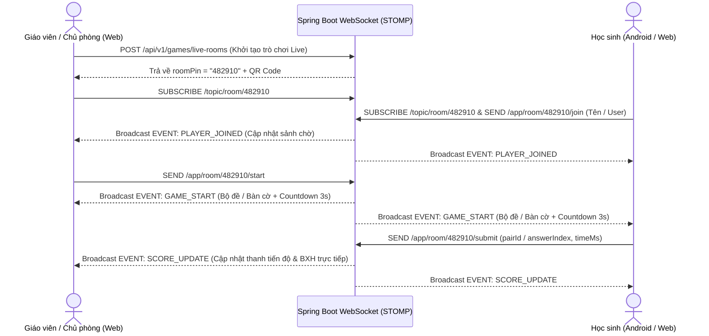
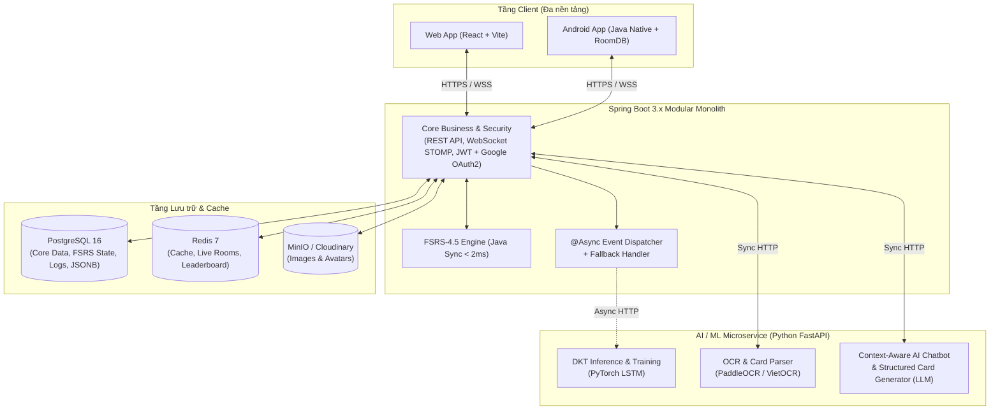
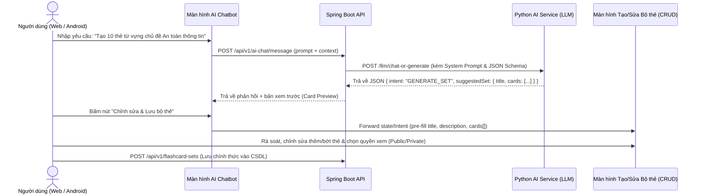

# Phân tích & Thiết kế Hệ thống Học tập Đa nền tảng Cá nhân hóa (SmartFlash / Quizlet-inspired)

Tài liệu này cung cấp bản thiết kế tổng thể cho đồ án tốt nghiệp: **"Nghiên cứu và xây dựng hệ thống học tập đa nền tảng cá nhân hóa sử dụng Spaced Repetition (FSRS) và Machine Learning (DKT) trên nền tảng Spring Boot, React và Android Native (Java)"**.

---

## 1. Tổng quan & Định hướng từ Quizlet System

Hệ thống kế thừa trải nghiệm học tập trực quan, đa chế độ của **Quizlet** trên cả Web và Mobile, đồng thời bổ sung lõi cá nhân hóa học thuật và trợ lý AI để giải quyết bài toán *"tạo thẻ nhanh – học đúng thứ cần học, vào đúng thời điểm"*:

| Khía cạnh | Tham khảo từ Quizlet | Nâng cấp & Cá nhân hóa trong Đồ án |
| :--- | :--- | :--- |
| **Lập lịch ôn tập** | Thuật toán lặp lại ngắt quãng cơ bản / tự đánh dấu | **FSRS (Free Spaced Repetition Scheduler)**: Mô hình hóa 3 tham số *Difficulty (D)*, *Stability (S)*, *Retrievability (R)* giúp dự đoán xác suất quên và tối ưu thời điểm ôn tập chính xác hơn SM-2. |
| **Cá nhân hóa lộ trình** | Gợi ý thẻ sai gần đây | **DKT (Deep Knowledge Tracing)**: Dùng mạng nơ-ron hồi quy (LSTM/GRU) theo dõi chuỗi lịch sử trả lời $(q_t, a_t)$ để ước lượng mức độ nắm vững từng khái niệm (Knowledge State), từ đó ưu tiên thẻ yếu và điều chỉnh độ khó bài kiểm tra. |
| **Trợ lý AI (Q-Chat)** | Q-Chat (Gia sư AI hỏi đáp) | **Context-Aware AI Chatbot & Flashcard Generator**: Trò chuyện theo đúng ngữ cảnh bộ thẻ đang học / tiến độ DKT của người dùng; hỗ trợ **yêu cầu tạo bộ thẻ bằng ngôn ngữ tự nhiên** rồi forward dữ liệu JSON sang điền sẵn (pre-fill) tại màn hình CRUD bộ thẻ. |
| **Nhập liệu bộ thẻ** | Nhập thủ công, import text, Magic Notes | **OCR Pipeline + AI Text/Document to Cards**: Chụp ảnh tài liệu/sách/vở ghi hoặc dán văn bản dài để tự động tách cặp *Thuật ngữ – Định nghĩa*. |
| **Môi trường học** | Flashcards, Learn, Test, Match, Folders, Classes | Đầy đủ trên cả **Web (React)** & **Android (Java Native)**, đồng bộ tiến độ thời gian thực, hỗ trợ **Streak & Thành tựu**. |

---

## 2. Phân tích Phân quyền Người dùng (RBAC)

Hệ thống chia làm **4 vai trò (Roles)** với phân cấp quyền rõ ràng:

| Vai trò | Mô tả | Quyền hạn chính |
| :--- | :--- | :--- |
| **1. Khách vãng lai (Guest)** | Người dùng chưa đăng nhập | • Xem trang chủ (Landing Page), tìm kiếm bộ thẻ `PUBLIC`.<br>• Xem trước (preview) bộ thẻ `PUBLIC` hoặc `LINK_ONLY` (qua link chia sẻ), có thể học thử Flashcard cơ bản nhưng **không lưu tiến trình FSRS/DKT/Streak**.<br>• Đăng ký, Đăng nhập (Email/Password hoặc Google OAuth2). |
| **2. Người dùng thông thường (User / Learner)** | Học sinh, sinh viên, người tự học | • Toàn quyền CRUD bộ thẻ cá nhân (thủ công, import, **OCR**, **tạo từ AI Chatbot**).<br>• Thiết lập quyền xem bộ thẻ: `PUBLIC` (công khai), `PRIVATE` (chỉ mình tôi), `LINK_ONLY` (ai có link/token mới xem được).<br>• Học qua vuốt thẻ **FSRS**, nhận gợi ý cá nhân hóa từ **DKT**, hỏi đáp với **AI Chatbot theo ngữ cảnh bộ thẻ**.<br>• Làm bài **Kiểm tra 4 đáp án**, chơi **Games** (Ghép thẻ, Sắp xếp từ/Thiên thạch).<br>• Tạo & quản lý **Thư mục (Folders)**, tạo/tham gia **Nhóm học (Study Groups)**.<br>• Tham gia **Lớp học** bằng mã mời, làm bài kiểm tra giáo viên giao.<br>• Quản lý tài khoản, xem **Chuỗi học (Streak)**, **Thành tựu (Badges)**, biểu đồ tiến độ. |
| **3. Giáo viên (Teacher)** | Giảng viên, người hướng dẫn | • Kế thừa toàn bộ quyền của *Người dùng thông thường*.<br>• Tạo & quản lý **Lớp học (Classes)** (tạo mã mời, duyệt/xóa học viên).<br>• **Chỉ định hoạt động (Assign an Activity)**: Chọn bộ thẻ và giao 1 trong các hoạt động (*Học/Learn*, *Thẻ ghi nhớ*, *Kiểm tra*, *Ghép thẻ*, *Đá quý/Gems*, *Khối hộp/Blocks*, *Blast*) kèm thời hạn; học sinh truy cập miễn phí qua link/mã (**không bắt buộc đăng nhập** hoặc có đăng nhập) và giáo viên theo dõi tiến độ trực tiếp.<br>• **Khởi tạo trò chơi Live (Host Live Game)**: Mở phòng thi đấu trực tiếp bằng mã PIN/QR cho cả lớp.<br>• Xem báo cáo chi tiết của lớp: điểm số, tỷ lệ hoàn thành, **mức độ nắm vững kiến thức (Knowledge Mastery từ DKT)** của từng học viên. |
| **4. Quản trị viên (Admin)** | Người vận hành hệ thống | • Truy cập **Admin Dashboard** (thống kê DAU/MAU, số bộ thẻ, lượt học, lượng request AI/OCR, tình trạng hệ thống).<br>• Quản lý người dùng: tìm kiếm, khóa/mở khóa tài khoản, phê duyệt/nâng cấp quyền *Giáo viên*.<br>• Kiểm duyệt nội dung: xử lý báo cáo vi phạm (Report), ẩn/xóa bộ thẻ vi phạm bản quyền hoặc nội dung xấu.<br>• Quản lý danh mục/chủ đề (Categories/Tags), cấu hình **System Prompt / Quota cho AI Chatbot** và bộ **Thành tựu (Achievements)** hệ thống. |

---

## 3. Phân tích các Module Chức năng Chi tiết

### Module 1: Xác thực, Quản lý Tài khoản & Quyền xem Trang cá nhân (Auth & Profile Privacy)
- **Đăng ký / Đăng nhập truyền thống**: Email + Password (mã hóa BCrypt), xác thực OTP/Email khi đăng ký hoặc quên mật khẩu.
- **Google Sign-In / Sign-Up**:
  - Web: Sử dụng Google Identity Services (OAuth2 Authorization Code / ID Token).
  - Android: Sử dụng Credential Manager / Google Sign-In SDK lấy `idToken` gửi về Spring Boot để verify qua Google public keys, tự động tạo tài khoản nếu chưa tồn tại và trả về JWT (`accessToken` + `refreshToken`).
- **Hồ sơ cá nhân**: Đổi mật khẩu, cập nhật avatar (lưu trên Object Storage), chọn mục tiêu học hàng ngày (ví dụ: 20 thẻ/ngày).
- **Phân quyền xem Trang cá nhân (`Profile Visibility`)**:
  - Người dùng (Học viên / Giáo viên) có trang hồ sơ `/profile/:username` hiển thị các tab: **Bộ thẻ đã tạo**, **Thư mục**, **Lớp học tham gia/giảng dạy**, **Chuỗi học & Thành tựu**.
  - Cho phép cài đặt quyền xem tổng thể trang cá nhân (`PUBLIC` – ai cũng xem được, `LOGGED_IN_ONLY` – chỉ thành viên hệ thống, `PRIVATE` – chỉ mình tôi) và bật/tắt hiển thị riêng từng tab (ví dụ: công khai tab *Bộ thẻ* nhưng ẩn tab *Lớp học* và *Thành tựu*).

### Module 2: Quản lý Bộ thẻ (Flashcard Set CRUD, OCR, AI Image & Clone)
- **CRUD Bộ thẻ**: Tiêu đề, mô tả, ngôn ngữ thuật ngữ/định nghĩa, thẻ gắn (tags), danh sách thẻ (Term, Definition, ví dụ/gợi ý, hình ảnh minh họa tùy chọn, audio phát âm TTS).
- **Tích hợp Hình ảnh cho Thẻ (Stock Search + AI Image Generation)**:
  - Tìm ảnh nhanh từ kho miễn phí (**Unsplash / Pixabay API**) ngay khi gõ `Term`.
  - Hoặc bấm **"Tạo ảnh minh họa bằng AI"** (gọi model tạo ảnh để sinh hình minh họa ghi nhớ từ vựng khó/trừu tượng).
- **Nhân bản & Chỉnh sửa (Clone / Fork Set)**: Cho phép lưu bản sao từ một bộ thẻ `PUBLIC` hoặc `LINK_ONLY` của người khác về tài khoản của mình để tùy biến thêm.
- **Phân quyền hiển thị (`Visibility`)**:
  - `PUBLIC`: Hiển thị trên trang tìm kiếm, ai cũng xem và clone được.
  - `PRIVATE`: Chỉ chủ sở hữu xem và sửa.
  - `LINK_ONLY`: Không xuất hiện trên tìm kiếm công khai; hệ thống sinh `shareToken` (UUID/NanoID), chỉ người có URL chứa token mới truy cập được.
- **OCR (Quét ảnh tạo thẻ)**:
  - Người dùng chụp ảnh (Android CameraX) hoặc upload ảnh (Web).
  - Ảnh được gửi tới **OCR Service** (PaddleOCR / Tesseract / VietOCR) để nhận diện vùng chữ, sau đó áp dụng rule hoặc LLM parser để gợi ý danh sách cặp *Term – Definition* cho người dùng chỉnh sửa trước khi lưu.

### Module 3: Lõi Học tập Thông minh (FSRS + DKT)
Đây là trọng tâm học thuật của đồ án:
1. **Học qua vuốt thẻ (FSRS)**:
   - Giao diện hiển thị mặt trước (Term), người dùng lật thẻ xem mặt sau (Definition) và đánh giá/vuốt theo 4 mức: `Again (1)`, `Hard (2)`, `Good (3)`, `Easy (4)`.
   - **FSRS Engine** (chạy trực tiếp trong Spring Boot bằng Java để đạt độ trễ thấp) tính toán lại `Stability (S)`, `Difficulty (D)`, `Retrievability (R)` và xác định `nextReviewAt` cho từng thẻ của từng người dùng (`user_card_progress`).
2. **Cá nhân hóa bằng DKT (Deep Knowledge Tracing)**:
   - Mỗi tương tác học tập (vuốt thẻ FSRS hoặc làm câu hỏi trắc nghiệm) tạo thành một bản ghi `learning_log(user_id, card_id/concept_id, is_correct, response_time, timestamp)`.
   - **DKT Service (Python FastAPI + PyTorch)**: Nhận chuỗi tương tác gần nhất của `user_id`, đưa qua mô hình LSTM để dự đoán vector xác suất $\hat{y} \in [0, 1]^N$ (khả năng trả lời đúng cho từng thẻ/khái niệm).
   - **Ứng dụng kết quả DKT**:
     - Sắp xếp ưu tiên các thẻ có xác suất nắm vững thấp ($\hat{y}_i < 0.6$) vào phiên học "Ôn tập thông minh (Smart Review)".
     - Hiển thị thanh/biểu đồ "Mức độ thành thạo (Mastery Level)" cho học viên và giáo viên.

### Module 4: Kiểm tra & Trò chơi (Test, Minigames & Real-time Multiplayer)
- **Học qua Kiểm tra (4 đáp án & Tự luận ngắn)**:
  - Hệ thống sinh đề tự động từ bộ thẻ: câu hỏi trắc nghiệm 4 đáp án (1 đáp án đúng + 3 đáp án nhiễu cùng bộ) và câu hỏi tự luận gõ từ.
  - Hỗ trợ tùy chỉnh số lượng câu, đảo chiều hỏi (Term → Def hoặc Def → Term), chấm điểm tức thì và lưu lịch sử làm bài vào DKT.

#### Phân tích Chi tiết Hệ thống Minigames (Chuẩn Quizlet mới nhất)
Bám sát bộ hoạt động và trò chơi hiện đại của Quizlet (**Ghép thẻ, Blast, Đá quý, Khối hộp, Live**), hệ thống hỗ trợ các minigame sau:

| Tên Minigame | Cơ chế chơi (Gameplay) | Giao diện Web vs Android | Liên kết FSRS / DKT |
| :--- | :--- | :--- | :--- |
| **1. Ghép thẻ (Match)** | Hiển thị lưới 6 cặp (12 ô trên Android) hoặc 8 cặp (16 ô trên Web) gồm `Term` và `Definition` xáo trộn. Người chơi chạm 2 ô khớp nhau để làm biến mất. Chọn sai bị rung cảnh báo và **phạt +1.0 giây** vào đồng hồ. | • **Web**: Lưới 4x4, click hoặc kéo-thả.<br>• **Android**: Lưới 3x4 (`GridLayout`/`RecyclerView`), chạm nối 2 thẻ. | Các cặp ghép sai được ghi nhận vào `learning_logs` (`is_correct = false`) để DKT hạ điểm Mastery và FSRS đẩy lịch ôn sớm hơn. |
| **2. Blast (Bắn thiên thạch)** | Bắn vào tàu/thiên thạch mang câu trả lời đúng trước khi hết thời gian. Trả lời đúng liên tiếp kích hoạt **Combo (x2, x3 điểm)**, tốc độ bay tăng dần theo vòng. | • **Web**: Click ngắm bắn hoặc phím tắt `1-2-3-4`.<br>• **Android**: Chạm trực tiếp vào thiên thạch đáp án đúng trên màn hình. | Ưu tiên lấy các thẻ có chỉ số `Difficulty (D)` cao trong FSRS hoặc xác suất DKT thấp làm mục tiêu nhiều điểm. |
| **3. Đá quý (Gems)** | Tạo các chuỗi đá quý (Match-3 / nối chuỗi năng lượng) bằng cách trả lời liên tiếp các câu hỏi nhanh từ bộ thẻ để tích lũy điểm chuỗi đá quý dài nhất. | Giao diện bảng đá quý trực quan (SVG/Canvas) kèm popup câu hỏi nhanh. | Củng cố phản xạ nhanh cho các thẻ đang ở trạng thái `Review` của FSRS. |
| **4. Khối hộp (Q-Blocks)** | Giống trò xếp hình khối (1010! / Block Puzzle) trên lưới 8x8: cứ mỗi lượt trả lời đúng 1–3 câu hỏi từ bộ thẻ, người chơi nhận được 3 khối hình để đặt vào bảng nhằm lấp đầy hàng/cột và ghi điểm. | • **Web & Android**: Kéo-thả hoặc chạm chọn vị trí đặt khối hình sau mỗi lượt trả lời đúng câu hỏi. | Câu hỏi hiện ra được chọn lọc thông minh bởi DKT (xen kẽ 70% thẻ yếu và 30% thẻ đã thuộc để giữ nhịp chơi). |
| **5. Trò chơi Live (Quizlet Live / 1v1 Race)** | Giáo viên hoặc Chủ phòng khởi tạo phòng sinh **mã PIN 6 số & QR Code**. Học sinh vào phòng chờ và thi đấu trực tiếp:<br>• **Mode A (Class Live Battle)**: Cá nhân hoặc chia đội ngẫu nhiên trả lời câu hỏi tốc độ.<br>• **Mode B (1v1 Match Race)**: Đua ghép thẻ trực tiếp, hiển thị thanh tiến độ đối thủ thời gian thực. | • **Web & Android**: Dùng chung giao thức **WebSocket (STOMP)** nên học sinh trên Web và Android có thể thi đấu chung trong 1 phòng! | Kết quả từng câu trong trận đấu vẫn được cập nhật ngầm vào lịch sử học cá nhân (nếu người chơi đã đăng nhập). |

#### Giải pháp Kỹ thuật cho Đồng bộ Thời gian thực (Real-time Multiplayer)
Việc làm tính năng nhiều người chơi chung thời gian thực cho game học tập **không khó** vì không cần đồng bộ tọa độ vật lý 60 FPS như game hành động, mà chỉ cần **Đồng bộ theo Sự kiện (Event-driven State Sync)**:
- **Công nghệ sử dụng**:
  - **Backend**: `spring-boot-starter-websocket` cấu hình **STOMP Message Broker** (`/topic/room/{pinCode}`).
  - **Lưu trạng thái phòng (Room State)**: Lưu trực tiếp trên RAM bằng `ConcurrentHashMap<String, GameRoomState>` (hoặc Redis) để đạt tốc độ đọc/ghi < 1ms. Chỉ khi trận đấu kết thúc (`GAME_OVER`) mới ghi bảng điểm xuống PostgreSQL.
  - **Web Client (React)**: Dùng thư viện `@stomp/stompjs`.
  - **Android Client (Java)**: Dùng `OkHttp WebSocket` hoặc `StompProtocolAndroid` lắng nghe cùng topic.
- **Xử lý chống lệch giờ & lag mạng (Anti-Lag)**:
  - Mỗi gói tin sự kiện chỉ nặng ~100 bytes JSON (`PLAYER_JOIN`, `START_GAME`, `PROGRESS_UPDATE`, `ROUND_RESULT`).
  - Ở chế độ *1v1 Match Race*, Server chỉ gửi duy nhất mảng thẻ đầu ván; khi người chơi ghép đúng 1 cặp chỉ gửi `{ "type": "MATCH_OK", "pairId": 12 }`, Server tăng biến đếm `clearedPairs` và broadcast `{ "userId": 5, "progress": "4/8" }` cho cả phòng.



### Module 5: Tổ chức, Lớp học & Công cụ Giáo viên (Folders, Groups, Teacher Activities & Live)
- **Thư mục (Folders)**: Gom nhiều bộ thẻ theo môn học/chủ đề (quan hệ N-N giữa Folder và FlashcardSet).
- **Nhóm học (Study Groups)**: Người dùng tạo nhóm, mời bạn bè qua mã/link, chia sẻ bộ thẻ vào nhóm, bảng xếp hạng Streak/XP trong nhóm.
- **Lớp học & Bộ công cụ Dành riêng cho Giáo viên (Teacher Suite)**:
  1. **Quản lý Lớp học (Classes)**: Giáo viên tạo lớp học (sinh `classCode`), quản lý danh sách học viên, gắn các bộ thẻ và thư mục vào lớp.
  2. **Chỉ định hoạt động (Assign an Activity — Chuẩn mẫu Quizlet)**:
     - Từ một bộ thẻ, giáo viên bấm **"Giao hoạt động (Assign activity)"** và chọn **1 trong 7 hoạt động để chỉ định**:
       - *Học (Learn)*: Học bằng các câu hỏi trắc nghiệm và tự luận.
       - *Thẻ ghi nhớ (Flashcards)*: Ôn tập và ghi nhớ thuật ngữ & định nghĩa.
       - *Kiểm tra (Test)*: Xem mức độ hiểu biết bằng bài kiểm tra nhanh.
       - *Ghép thẻ (Match)*: Chơi trò chơi ghép thẻ với thuật ngữ và định nghĩa.
       - *Đá quý (Gems)*: Tạo các chuỗi đá quý và trả lời câu hỏi.
       - *Khối hộp (Blocks)*: Trả lời đúng các câu hỏi để kiếm được các khối hình.
       - *Blast*: Bắn vào nhiều câu trả lời đúng trước khi hết thời gian.
     - **Cấu hình & Chia sẻ linh hoạt**: Giáo viên đặt thời gian bắt đầu, hạn chót (deadline), ghi chú dặn dò và nhận **Link / Mã tham gia hoạt động** (`activityCode`).
     - **Hỗ trợ truy cập miễn phí & Không cần đăng nhập**: Học sinh mở link hoặc nhập mã hoạt động có thể chỉ cần **nhập Họ tên / Mã học sinh (Guest Participant)** để làm ngay hoạt động giáo viên chỉ định mà không bắt buộc phải tạo tài khoản (hoặc nếu đã đăng nhập thì tự động gắn với tài khoản để cộng Streak & cập nhật DKT).
     - **Theo dõi tiến độ (Activity Progress Tracking)**: Giáo viên có màn hình báo cáo thời gian thực xem danh sách học sinh *Đã hoàn thành / Đang làm*, điểm số, thời gian hoàn thành và thống kê những thuật ngữ cả lớp trả lời sai nhiều nhất.
  3. **Khởi tạo Trò chơi Live trên lớp (Host Live Game)**:
     - Giáo viên bấm **"Chơi Live"** từ bộ thẻ, chọn chế độ (*Cá nhân* hoặc *Chia đội ngẫu nhiên*), chiếu màn hình mã PIN 6 số & mã QR lên máy chiếu để học sinh dùng điện thoại Android hoặc Web quét vào thi đấu trực tiếp.

### Module 6: Gamification (Streak & Thành tựu)
- **Chuỗi học (Streak)**: Ghi nhận mỗi ngày người dùng hoàn thành ít nhất 1 phiên học/kiểm tra (tính theo múi giờ người dùng). Có cơ chế thông báo nhắc học trước khi mất chuỗi.
- **Thành tựu (Achievements / Badges)**: Mở khóa huy hiệu theo cột mốc (ví dụ: *Chuỗi 7 ngày*, *Tạo bộ thẻ đầu tiên*, *Hoàn thành 100 thẻ FSRS*, *Đạt 100% bài kiểm tra*).

### Module 7: Quản trị Hệ thống (Admin Portal — Tham chiếu Quizlet & Giám sát AI)
Tham chiếu hệ thống vận hành của **Quizlet** kết hợp đặc thù **FSRS + DKT + AI Chatbot + OCR**, phân hệ Quản trị viên (`ROLE_ADMIN`) gồm **7 nhóm chức năng chuyên sâu**:
1. **Dashboard Tổng quan & Phân tích Học thuật (Executive & Learning Analytics)**:
   - Thống kê tăng trưởng DAU/MAU, số lượng Học viên / Giáo viên, số bộ thẻ mới, số lớp học và phòng chơi Live đang mở.
   - Thống kê chất lượng học tập: Tổng lượt ôn thẻ FSRS, tỷ lệ nhớ trung bình (Average Retention Rate) và tỷ lệ sử dụng từng chế độ học (*Flashcard, Learn, Test, Match, Blast, Gems, Blocks, Live*).
2. **Quản lý Người dùng & Xác minh Giáo viên (`Verified Teacher / Creator`)**:
   - Tìm kiếm, lọc user, khóa tạm thời có thời hạn (`SUSPENDED` + lý do) hoặc khóa vĩnh viễn (`BANNED`), thu hồi phiên đăng nhập.
   - **Duyệt yêu cầu nâng cấp Giáo viên (`teacher_verification_requests`)**: Xác minh thông tin trường học / email `.edu` / thẻ giảng viên để cấp `ROLE_TEACHER` và gắn huy hiệu **Verified Teacher** (giống tích xác minh của Quizlet).
3. **Quản lý Cây Danh mục Môn học & Bộ thẻ Nổi bật (`Subject Taxonomy & Featured Sets`)**:
   - CRUD cây danh mục đa cấp trên trang Khám phá (*Ngoại ngữ → IELTS/TOEIC/JLPT*, *CNTT*, *Y học*, *Toán học*...) kèm icon và màu sắc.
   - Ghim/Gỡ các bộ thẻ chất lượng cao lên mục **"Bộ thẻ Nổi bật (Featured Sets)"** trên trang chủ.
4. **Kiểm duyệt Nội dung Đa đối tượng & Từ khóa Nhạy cảm (`Trust & Safety`)**:
   - Xử lý báo cáo vi phạm (`content_reports`) cho cả 4 đối tượng: **Bộ thẻ (`SET`)**, **Lớp học (`CLASS`)**, **Nhóm học (`GROUP`)**, và **Người dùng (`USER`)** (lộ đề thi bản quyền, spam, nội dung xấu) với các hành động: *Bỏ qua, Ép chuyển về Private, Xóa mềm, Cảnh cáo hoặc Khóa chủ sở hữu*.
   - Quản lý **Từ điển Từ khóa Cấm (`sensitive_keywords`)**: Tự động gắn cờ (`FLAGGED`) bộ thẻ công khai chứa từ nhạy cảm để đưa vào hàng đợi chờ Admin duyệt.
5. **Giám sát Tài nguyên AI & Cấu hình Hệ thống Động (`AI Monitoring & System Settings`)**:
   - Theo dõi số lượt gọi AI Chatbot, số bộ thẻ sinh bằng AI, số lượt quét OCR, lượng token tiêu thụ, độ trễ trung bình (`latency_ms`) và tỷ lệ Fallback của `ai-ml-service` (`ai_usage_logs`).
   - Chỉnh trực tiếp trên giao diện: Hạn mức (Quota) chat AI / quét OCR miễn phí mỗi ngày cho từng Role, chỉnh `System Prompt` mẫu của Chatbot, và cập nhật tham số mặc định $w$ của thuật toán FSRS (`system_settings`).
6. **Quản trị Gamification (CRUD Huy hiệu Thành tựu)**:
   - Thêm/sửa/xóa bộ huy hiệu `achievements`, chỉnh ngưỡng mở khóa và điểm thưởng XP.
7. **Thông báo Toàn hệ thống & Nhật ký Kiểm toán (`Announcements & Audit Logs`)**:
   - Đăng thông báo/banner toàn hệ thống (`system_announcements`) gửi tới hộp thư thông báo (`user_notifications`) trên Web & Android; tra cứu lịch sử mọi thao tác của Admin (`admin_audit_logs`).

### Module 8: AI Chatbot Tùy biến Ngữ cảnh & Tạo Bộ thẻ Tự động (Q-Chat Inspired)
Module này giúp hệ thống vượt trội hơn các ứng dụng Flashcard truyền thống:
1. **Tuỳ biến ngữ cảnh riêng của hệ thống (Context Injection / RAG nhẹ)**:
   - Khi người dùng mở Chatbot ở **Trang chủ**: Chatbot nhận ngữ cảnh gồm *Hồ sơ người học + Danh sách các thẻ đang yếu (lấy từ DKT & FSRS)* để tư vấn hôm nay nên ôn gì.
   - Khi người dùng mở Chatbot ở **Chi tiết bộ thẻ / Màn hình học**: Chatbot tự động được nạp toàn bộ danh sách `(Term, Definition)` của bộ thẻ hiện tại vào System Prompt. Người học có thể yêu cầu: *"Giải thích kỹ hơn thẻ số 3"*, *"Cho tôi câu ví dụ ghép 5 từ vựng đầu tiên"*, hoặc *"Đố tôi 3 câu hỏi tình huống từ bộ thẻ này"*.
2. **Yêu cầu tạo bộ thẻ & Forward sang trang CRUD (Pre-fill Flow)**:
   - Người dùng chat: *"Tạo giúp tôi bộ 15 thẻ ôn tập về Mạng máy tính (мо hình OSI và TCP/IP)"* hoặc dán một đoạn bài giảng vào khung chat.
   - AI trả về phản hồi dạng **Structured Output (JSON)** chứa:
     - `intent`: `"GENERATE_FLASHCARD_SET"` (hoặc `"GENERAL_CHAT"`)
     - `suggestedSet`: `{ title, description, tags, cards: [{ term, definition }] }`
   - Giao diện Chat hiển thị một **Card Preview** ngay trong khung chat kèm nút **"Mở trong trình tạo thẻ (Chỉnh sửa & Lưu)"**:
     - **Trên Web (React)**: Điều hướng `navigate('/sets/create', { state: { prefillData: suggestedSet } })` để mở trang `Set Editor` với toàn bộ tiêu đề, mô tả và danh sách thẻ đã được điền sẵn vào form. Người dùng chỉ việc rà soát, sửa/xóa thẻ tùy ý rồi bấm **Lưu**.
     - **Trên Android (Java)**: Truyền object `SuggestedSetDto` (implement `Serializable` / `Parcelable`) qua `Intent.putExtra("PREFILL_SET_DATA", suggestedSet)` mở `CreateEditSetActivity`, tự động đổ dữ liệu vào `EditText` và `RecyclerView` adapter để người dùng chỉnh sửa trước khi gọi API tạo bộ thẻ.

---

## 4. Các Chức năng Còn thiếu so với Quizlet (Đề xuất Bổ sung)

Ngoài các module bạn đã liệt kê, đối chiếu với hệ sinh thái Quizlet hiện đại và tiêu chuẩn chấm đồ án tốt nghiệp, dưới đây là các tính năng **rất nên bổ sung** (sắp xếp theo mức độ khả thi cao – điểm cộng lớn):

| Nhóm tính năng | Tính năng đề xuất | Lý do nên có & Độ khó triển khai |
| :--- | :--- | :--- |
| **1. Đa phương tiện & Trải nghiệm thẻ** | **Text-to-Speech (TTS) & Phát âm tự động** | Quizlet phát âm cả Term và Definition. Rất dễ làm: Web dùng `window.speechSynthesis`, Android dùng `android.speech.tts.TextToSpeech` (miễn phí 100%, không tốn API), cực kỳ hữu ích khi học ngoại ngữ. |
| **2. Chế độ "Learn" thích ứng (Adaptive Learn Mode)** | **Lộ trình học 3 bước (Làm quen → Trắc nghiệm → Tự gõ từ)** | Trên Quizlet, ngoài vuốt thẻ và Test còn có chế độ **Learn**: câu dễ thì hỏi trắc nghiệm 4 đáp án, khi chỉ số DKT/FSRS đã cao thì nâng cấp lên bắt **gõ lại từ (Written/Typing)** để nhớ sâu. Kết hợp DKT vào đây sẽ làm nổi bật phần Machine Learning trong đồ án! |
| **3. Tiện ích nhập/xuất nhanh** | **Import/Export hàng loạt (Copy-Paste từ Word/Excel/CSV) & Magic Notes (Từ PDF/Docx)** | Trên Quizlet có khung "Nhập nhanh": dán đoạn text cách nhau bởi dấu `Tab` hoặc `;` là tách ngay hàng chục thẻ trong 1 giây. Ngoài ra có thể cho phép upload file `.pdf` / `.docx` để AI tóm tắt và đẩy thẳng sang trang tạo thẻ CRUD. |
| **4. Tương tác Cộng đồng & Tái sử dụng** | **Clone (Nhân bản bộ thẻ), Đánh giá (Star Rating) & Đánh dấu thẻ khó (Starred Cards)** | • **Star/Bookmark từng thẻ lẻ**: Trong bộ 50 thẻ, người học gắn dấu sao (`★`) cho 10 thẻ hay quên để chỉ ôn riêng 10 thẻ đó.<br>• **Clone bộ thẻ**: Thấy bộ thẻ Public hay, bấm "Lưu bản sao về thư viện của tôi" để sửa theo ý mình. |
| **5. Chế độ học nhóm trực tiếp (Tùy chọn nâng cao)** | **Quizlet Live thu nhỏ (Đấu trường thời gian thực qua WebSocket)** | Giáo viên hoặc trưởng nhóm mở phòng thi đấu nhanh (nhập mã PIN 6 số), các thành viên trả lời nhanh bộ thẻ trên điện thoại/web (dùng Spring WebSocket / STOMP). Tính năng này khi demo trước hội đồng bảo vệ đồ án cực kỳ ấn tượng. |
| **6. Học Offline & Nhắc nhở thông minh** | **Offline Sync (RoomDB) & Smart Push Notification (FCM)** | Android lưu sẵn các bộ thẻ cần ôn tập hôm nay vào RoomDB để học trên xe buýt/nơi không có mạng; Firebase Cloud Messaging (FCM) gửi thông báo khi sắp mất Streak hoặc khi có thẻ đến hạn FSRS. |

### 4.1. Giải pháp Tạo hình ảnh, Đồ họa Giao diện (UI Illustrations) & Ảnh Thẻ bằng Mô hình AI
Giao diện Quizlet nổi bật nhờ các hình minh họa vector phẳng (Flat Illustrations như banner bên trái màn hình *Giao hoạt động*), các icon động (*Đá quý, Khối hộp, Tên lửa Blast*), huy hiệu thành tựu (Badges) và ảnh đính kèm trong từng thẻ. Hệ thống áp dụng 3 giải pháp sau:

| Loại hình ảnh cần tạo | Mô hình / Công cụ đề xuất | Cách tích hợp vào Dự án |
| :--- | :--- | :--- |
| **1. Hình minh họa UI (Banners, Empty States, Badges, Icon Hoạt động, Game Sprites)** | • **Google Gemini Image Generation (Imagen 3)** *(tích hợp sẵn trong subagent `image-generator` của Antigravity)*<br>• **Recraft V3 (Recraft.ai)**: Mô hình AI chuyên sinh ảnh **Flat Vector `.SVG`** đồng bộ bảng màu палитра giống hệt thiết kế của Quizlet.<br>• **LottieFiles**: Cho hiệu ứng động (lửa Streak, pháo hoa, đá quý lấp lánh). | Gen sẵn bộ assets trong quá trình phát triển FE và đóng gói trực tiếp vào `frontend-web/src/assets/` (Web) và `res/drawable/` (Android) để tải tức thì (0ms latency). |
| **2. Ảnh đính kèm trong từng thẻ Flashcard (Khi người dùng đang tạo thẻ)** | • **Kho ảnh thực tế (Ưu tiên số 1)**: **Unsplash API / Pixabay API / Pexels API** (Miễn phí, trả kết quả JSON ảnh trong 0.2s theo từ khóa `Term`).<br>• **Mô hình AI sinh ảnh tự động theo ngữ cảnh thẻ**: **Gemini Imagen 3 API**, **Flux.1-schnell** (qua Together/Replicate) hoặc **Pollinations.ai** (`https://image.pollinations.ai/prompt/{term}`, miễn phí 100% không cần API key). | Trong màn hình `Set Editor`, bên cạnh mỗi thẻ có nút **"Thêm ảnh"**: Tab 1 tìm ảnh nhanh từ Pixabay/Unsplash; Tab 2 bấm **"Tạo ảnh AI"** để tự sinh hình minh họa giúp nhớ từ vựng trừu tượng, sau đó lưu URL lên **MinIO / Cloudinary**. |

---

## 5. Phân tích các Màn hình Giao diện (Web & Mobile)

### 5.1. Giao diện Web (React)
Bố cục chuẩn **Sidebar trái + Topbar tìm kiếm + Vùng nội dung chính + Floating AI Chatbot Drawer (Góc phải dưới)**:

1. **Public & Auth**:
   - `Landing / Explore Page`: Thanh tìm kiếm bộ thẻ công khai, danh mục nổi bật, nút **Nhập mã tham gia Hoạt động / Live Game** (không cần đăng nhập), nút Đăng nhập.
   - `Login / Register Modal & Page`: Form đăng nhập, nút **Continue with Google**, quên mật khẩu.
2. **Learner Workspace**:
   - `Dashboard (Home)`: Thẻ Streak hiện tại, nút "Ôn tập thông minh hôm nay (FSRS + DKT)", bộ thẻ học gần đây, tiến độ mục tiêu ngày.
   - `Library (Thư viện cá nhân)`: Tab *Bộ thẻ của tôi*, *Thư mục*, *Đã lưu*, *Nhóm học*.
   - `Set Editor (Tạo/Sửa bộ thẻ)`:
     - Nhập danh sách thẻ dạng bảng, chọn quyền xem (`Public/Private/Link-only`), chèn ảnh (Unsplash/Pixabay hoặc **AI Image Gen**).
     - Hỗ trợ nhận dữ liệu **Pre-fill từ AI Chatbot**, nút **Import từ ảnh (OCR)** và **Import nhanh từ văn bản (CSV/Tab)**.
   - `Set Detail (Chi tiết bộ thẻ)`: Danh sách thuật ngữ (kèm nút loa TTS và nút gắn sao `★`), nút Clone bộ thẻ, nút Share Link, chọn chế độ học (*Flashcard FSRS*, *Học/Learn*, *Kiểm tra*, *Ghép thẻ*, *Đá quý*, *Khối hộp*, *Blast*, *Hỏi AI*).
   - `Study - Flashcard Mode`: Thẻ 3D lật mượt, thanh tiến trình, 4 nút đánh giá FSRS (*Again / Hard / Good / Easy*) kèm hiển thị thời gian lặp lại dự kiến.
   - `Study - Test & Adaptive Learn Mode`: Giao diện làm bài trắc nghiệm 4 đáp án + câu hỏi tự luận gõ từ, chấm điểm tức thì & giải thích bằng AI.
   - `Study - Game Mode`: Giao diện chơi *Ghép thẻ (Match)*, *Đá quý (Gems)*, *Khối hộp (Blocks)*, *Blast* và sảnh đấu *Live Arena*.
   - `AI Chatbot Drawer / Page (Q-Chat)`: Khung chat nổi hoặc toàn màn hình, hiển thị badge ngữ cảnh hiện tại, nút bấm **"Chuyển danh sách này sang Trang Tạo Thẻ"** khi AI sinh xong bộ thẻ.
   - `Folder / Group / Class Detail`: Danh sách bộ thẻ thành phần, thành viên, bảng xếp hạng nhóm, danh sách hoạt động được giao của lớp.
   - `User Profile & Privacy Settings`: Trang cá nhân (`/users/:username`) hiển thị các tab *Bộ thẻ*, *Thư mục*, *Lớp học*, *Chuỗi học & Thành tựu* kèm **Modal Cài đặt quyền xem Trang cá nhân** (`Public` / `Logged-in` / `Private` hoặc ẩn/hiện từng tab).
3. **Teacher Portal (Tích hợp trực tiếp cho tài khoản Giáo viên)**:
   - `Assign Activity Modal / Page (Giao hoạt động — giống ảnh mẫu Quizlet)`:
     - Cột trái: Banner minh họa *"Giao hoạt động để duy trì tương tác với học sinh"* (Theo dõi tiến độ, Không cần đăng nhập, Truy cập miễn phí).
     - Cột phải: Radio list **"Chọn một hoạt động để chỉ định"** gồm 7 lựa chọn (*Học*, *Thẻ ghi nhớ*, *Kiểm tra*, *Ghép thẻ*, *Đá quý*, *Khối hộp*, *Blast*) → Bước tiếp theo chọn Lớp học / Hạn chót và xuất Link/Mã chia sẻ.
   - `Activity Progress & Class Dashboard`: Theo dõi trực tiếp ai đã làm, điểm số, thống kê thẻ khó và biểu đồ DKT Mastery của cả lớp.
   - `Live Game Host Screen (Khởi tạo Trò chơi Live)`: Màn hình chiếu mã PIN 6 số + QR Code, danh sách học sinh/đội đang vào sảnh chờ, nút *Bắt đầu trận đấu* và bảng xếp hạng trực tiếp.
4. **Admin Portal (`/admin/*`)**:
   - `Admin Executive Dashboard`: KPI cards, biểu đồ tăng trưởng User/Sets, tỷ lệ nhớ FSRS, phân bố chế độ học và biểu đồ giám sát AI/OCR (`ai_usage_logs`).
   - `User & Teacher Verification Management`: Bảng lọc user, khóa tạm thời/vĩnh viễn, tab **Duyệt hồ sơ Giáo viên (`Verified Teacher`)**.
   - `Category Taxonomy & Featured Sets`: Quản lý cây danh mục môn học và ghim bộ thẻ nổi bật lên trang Explore.
   - `Trust & Safety Moderation`: Hàng đợi xử lý báo cáo vi phạm đa đối tượng (`SET / CLASS / GROUP / USER`), duyệt bộ thẻ bị gắn cờ (`FLAGGED`) và quản lý từ điển `sensitive_keywords`.
   - `AI Config, Achievements & Announcements`: Chỉnh Quota AI/OCR, System Prompt, CRUD huy hiệu thành tựu, đăng thông báo hệ thống và xem `admin_audit_logs`.

### 5.2. Giao diện Mobile (Android Native - Empty Views Activity + Java)
Sử dụng **Single-Activity hoặc Multi-Activity kết hợp Fragment + BottomNavigationView + FloatingActionButton (Mở AI Chatbot)**:

1. `SplashActivity` & `LoginActivity`: Kiểm tra JWT trong `EncryptedSharedPreferences`, đăng nhập Email/Password hoặc **Google Sign-In**.
2. `MainActivity` (chứa `BottomNavigationView`):
   - **HomeFragment**: Streak widget, danh sách "Cần ôn tập hôm nay (FSRS)", gợi ý từ DKT, nút mở nhanh **AI Tutor Chatbot**.
   - **SearchFragment**: Tìm kiếm bộ thẻ `PUBLIC`, lọc theo tag/chủ đề.
   - **CreateBottomSheet**: Menu tạo nhanh: *Tạo thủ công*, *Nhờ AI Chatbot tạo*, *Quét OCR bằng Camera*, *Tạo Thư mục*.
   - **LibraryFragment**: TabLayout (`Bộ thẻ` | `Thư mục` | `Nhóm & Lớp học`).
   - **ProfileFragment**: Avatar, Streak, Huy hiệu thành tựu, Cài đặt thông báo nhắc học.
3. `AiChatActivity` (hoặc `AiChatBottomSheetDialogFragment`):
   - `RecyclerView` hiển thị tin nhắn người dùng, tin nhắn AI và **ViewType đặc biệt cho Flashcard Set Preview**.
   - Khi người dùng bấm nút *"Điền vào trang tạo thẻ"* trên card preview của AI, thực hiện `startActivity(intent)` sang `CreateEditSetActivity` kèm `PREFILL_SET_DATA`.
4. `CreateEditSetActivity`: `RecyclerView` nhập cặp Term-Definition (nhận dữ liệu pre-fill từ AI Chatbot hoặc từ `OcrScannerActivity`), Spinner chọn quyền xem (`Public/Private/Link-only`).
5. `SetDetailActivity`: Thông tin bộ thẻ, nút Share Link, nút mở AI Chat với ngữ cảnh của bộ thẻ hiện tại, các card chọn chế độ học, danh sách thẻ có nút phát âm `TextToSpeech` và gắn sao `★`.
6. `FlashcardStudyActivity`: Custom swipeable card stack / `ViewPager2` + `ObjectAnimator` hiệu ứng lật thẻ 3D; thao tác vuốt trái/phải hoặc bấm 4 nút FSRS (*Again, Hard, Good, Easy*). Hỗ trợ lưu tạm offline bằng **RoomDB**.
7. `TestActivity` & `GameMatchActivity`: Làm bài trắc nghiệm 4 đáp án và ghép cặp thẻ tính giờ.
8. `ClassDetailActivity`: Xem bộ thẻ lớp học, làm bài kiểm tra giáo viên giao; Giáo viên xem danh sách học viên & điểm số.

---

## 6. Đề xuất Kiến trúc Dự án

### 6.1. Kiến trúc Tổng thể: Hybrid Modular Monolith + AI Microservice (Đã Tối ưu hóa)

#### Tại sao đây là kiến trúc tối ưu nhất cho đề tài này?
1. **Không Over-engineering (Tránh chia vụn Microservices không cần thiết)**: Toàn bộ các module nghiệp vụ có quan hệ dữ liệu chặt chẽ (*Auth, User, Flashcard, Study FSRS, Classroom, Gamification, Admin*) được đặt trong một **Spring Boot 3.x Modular Monolith** dùng chung **PostgreSQL 16**. Điều này giúp đảm bảo **ACID Transaction** tức thì, không tốn tài nguyên RAM/CPU cho hàng chục container Java và dễ dàng triển khai.
2. **Tách riêng AI/ML Microservice (Python FastAPI) đúng chỗ cần tách**: Các tác vụ nặng về tính toán ma trận/tensor gồm **DKT (PyTorch LSTM)**, **OCR (PaddleOCR/VietOCR)** và **LLM Structured Generator** được tách sang Python — hệ sinh thái chuẩn nhất cho Machine Learning.
3. **3 Cơ chế Tối ưu Hiệu năng & Chịu lỗi (Optimization Patterns)**:
   - **Bất đồng bộ hóa DKT (`@Async` Non-blocking Pipeline)**: Khi người dùng vuốt 1 thẻ, **FSRS Engine (Java)** tính toán xong `Stability (S)`, `Difficulty (D)`, `nextReviewAt` trong **< 2ms** và trả kết quả ngay lập tức cho giao diện Web/Android lật sang thẻ tiếp theo. Việc ghi `learning_logs` và gọi sang Python FastAPI để cập nhật xác suất nắm vững `dkt_mastery_prob` được đẩy chạy ngầm (`@Async`), đảm bảo **0ms độ trễ chờ AI** khi đang vuốt thẻ.
   - **Circuit Breaker & Graceful Fallback**: Nếu `ai-ml-service` (Python) đang bảo trì hoặc quá tải, Spring Boot tự động chuyển sang chế độ **Fallback**: vẫn xếp lịch học bình thường bằng thuật toán FSRS thuần kết hợp Heuristic (ưu tiên thẻ có `difficulty` cao và `lapses` nhiều) mà không làm gián đoạn trải nghiệm người học.
   - **Tận dụng sức mạnh PostgreSQL 16 + Redis**: Sử dụng `JSONB`, `TEXT[]` với `GIN Index` cho tìm kiếm bộ thẻ và cấu hình động; dùng B-Tree Index kép `(user_id, next_review_at)` giúp truy vấn thẻ đến hạn trong < 3ms kể cả khi bảng có hàng triệu bản ghi.



### 6.2. Luồng AI Chatbot Tạo Bộ thẻ & Forward sang Trang CRUD



---

## 7. Cấu trúc Thư mục Dự án (Project Directory Structure)

```text
elearning-system/
├── docker-compose.yml                 # Chạy PostgreSQL 16, Redis 7, MinIO, Spring Boot, AI Service
├── system_design.md                   # Tài liệu phân tích & thiết kế tổng thể hệ thống
├── FEATURE.md                         # Danh sách phân rã các Task nguyên tử (T1.1 -> T8.4)
├── AGENTS.md                          # Luật code, Stack công nghệ, Quy ước đặt tên & Mệnh lệnh cho Agent
├── CLAUDE.md                          # Trạng thái hiện tại của dự án + CHANGELOG theo từng buổi code
├── PROJECT_STATE.md                   # Bản đồng bộ trạng thái dự án (Đã xong / Đang dở / Kế tiếp)
├── docs/
│   └── DATABASE.md                    # Thiết kế chi tiết 20+ bảng PostgreSQL, ERD, Quy ước cột & Index
│
├── backend-springboot/                # Backend chính (Java 17/21, Spring Boot 3.x)
│   ├── pom.xml
│   └── src/main/java/com/elearning/
│       ├── config/                    # SecurityConfig, CorsConfig, SwaggerConfig, RedisConfig, WebSocketConfig
│       ├── security/                  # JwtTokenProvider, JwtAuthFilter, GoogleOAuth2Verifier, CustomUserDetails
│       ├── common/                    # ApiResponse, GlobalExceptionHandler, BaseEntity, PageableUtils
│       ├── module/
│       │   ├── auth/                  # AuthController, AuthService, DTOs
│       │   ├── user/                  # User, Role, Streak, Achievement, UserController/Service/Repo
│       │   ├── flashcard/             # FlashcardSet, Flashcard, Folder, Visibility, ShareToken, StarredCard
│       │   ├── study/                 # FSRS Engine (FsrsScheduler.java, FsrsCardState.java), StudyController
│       │   ├── assessment/            # Adaptive Learn, Test 4 đáp án (DistractorGenerator), Games Leaderboard
│       │   ├── chatbot/               # AiChatController, AiChatService, ChatSession, ContextBuilder
│       │   ├── classroom/             # Class, ClassMember, Quiz, QuizAttempt (Teacher features)
│       │   ├── group/                 # StudyGroup, GroupMember
│       │   └── admin/                 # AdminDashboardController, ModerationReport, SystemStats
│       └── client/                    # RestClient gọi sang Python AI Service (DktClient, OcrClient, LlmChatClient)
│
├── ai-ml-service/                     # Microservice AI/ML (Python 3.10+, FastAPI)
│   ├── requirements.txt
│   ├── Dockerfile
│   └── app/
│       ├── main.py                    # FastAPI entry point (/dkt/*, /ocr/*, /chatbot/*)
│       ├── dkt/
│       │   ├── model.py               # Kiến trúc mạng LSTM Deep Knowledge Tracing (PyTorch)
│       │   ├── train.py               # Script huấn luyện model từ dataset
│       │   ├── predictor.py           # Load weights & suy luận xác suất nắm vững
│       │   └── weights/               # Lưu file .pt đã train
│       ├── ocr/
│       │   ├── extractor.py           # PaddleOCR / Tesseract / VietOCR
│       │   └── card_parser.py         # Tiền xử lý ảnh & tách cặp Term - Definition
│       └── chatbot/
│           ├── context_prompt.py      # Xây dựng System Prompt theo ngữ cảnh bộ thẻ & kết quả DKT
│           ├── generator.py           # Gọi LLM (Gemini/OpenAI/Local) với Structured JSON Schema
│           └── schemas.py             # Pydantic models cho SuggestedFlashcardSet
│
├── frontend-web/                      # Web Frontend (React + Vite + TailwindCSS)
│   ├── package.json
│   └── src/
│       ├── api/                       # Axios instance, các file gọi API theo module
│       ├── components/                # FlashcardFlip, FsrsRatingBar, OcrModal, AiChatDrawer, GeneratedSetPreviewCard
│       ├── features/                  # auth, flashcards, study, games, chatbot, classroom, admin
│       ├── hooks/                     # useAuth, useStreak, useTts (Text-to-Speech)
│       ├── layouts/                   # MainLayout (nhúng AiChatDrawer), AuthLayout, AdminLayout
│       ├── pages/                     # HomePage, SetEditorPage (nhận location.state.prefillData), SetDetailPage...
│       ├── routes/                    # ProtectedRoute (check Role: Guest/User/Teacher/Admin)
│       └── store/                     # Zustand / Redux Toolkit (authStore, studySessionStore, chatContextStore)
│
└── mobile-android/                    # Android Native (Java, Empty Views Activity, MVVM)
    ├── build.gradle
    └── app/src/main/
        ├── AndroidManifest.xml
        ├── java/com/elearning/app/
        │   ├── data/
        │   │   ├── local/             # RoomDatabase, DAOs (lưu thẻ & tiến độ FSRS offline), TokenManager
        │   │   ├── remote/            # RetrofitClient, AuthInterceptor, ApiService interfaces
        │   │   └── repository/        # AuthRepository, FlashcardRepository, StudyRepository, ChatRepository
        │   ├── model/                 # POJO / DTOs (SuggestedSetDto implements Serializable, FlashcardSet...)
        │   ├── ui/
        │   │   ├── auth/              # LoginActivity, RegisterActivity (Google Sign-In)
        │   │   ├── main/              # MainActivity, HomeFragment, SearchFragment, LibraryFragment, ProfileFragment
        │   │   ├── chatbot/           # AiChatBottomSheet, ChatMessageAdapter (hỗ trợ nút Forward sang CreateEditSet)
        │   │   ├── flashcard/         # CreateEditSetActivity (nhận Intent PREFILL_SET_DATA), SetDetailActivity, OcrScannerActivity
        │   │   ├── study/             # FlashcardStudyActivity, AdaptiveLearnActivity, TestActivity, GameMatchActivity
        │   │   ├── classroom/         # ClassListActivity, ClassDetailActivity, QuizTakeActivity
        │   │   └── common/            # Custom Views, Adapters, Dialogs
        │   └── utils/                 # DateUtils, TtsHelper (TextToSpeech), NetworkUtils, WorkManagerSync
        └── res/                       # layout/, drawable/, menu/, values/
